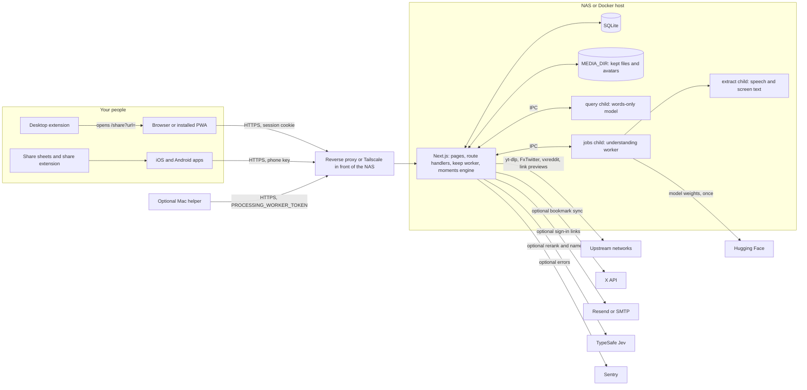
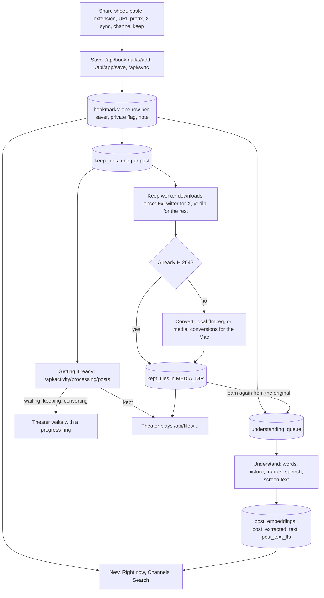
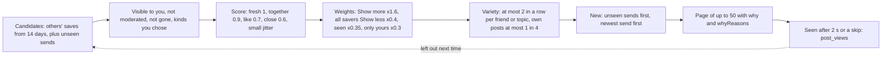
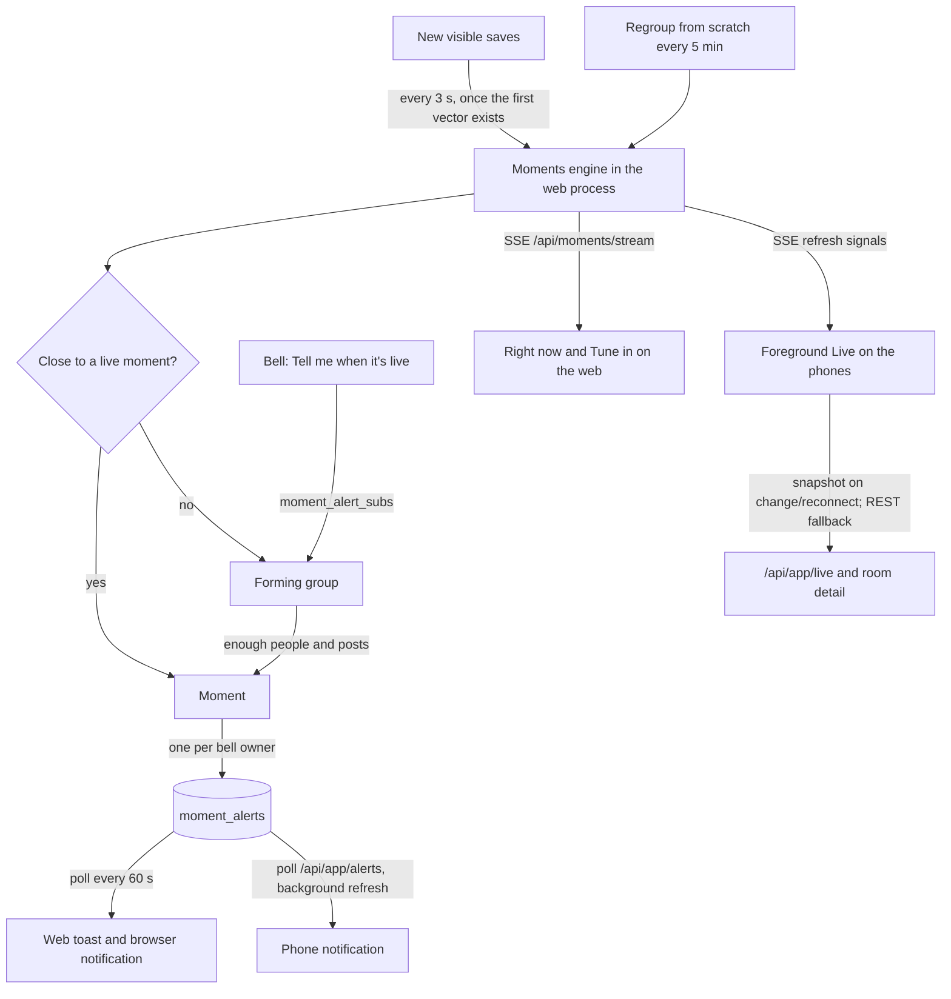
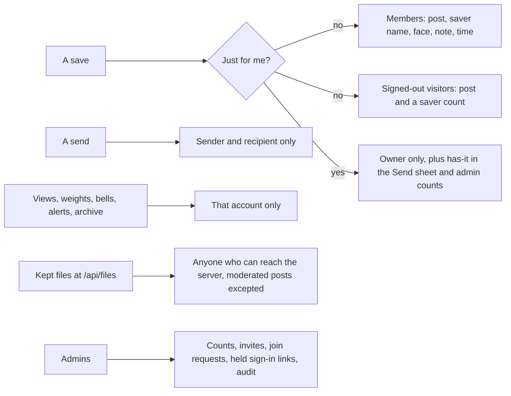
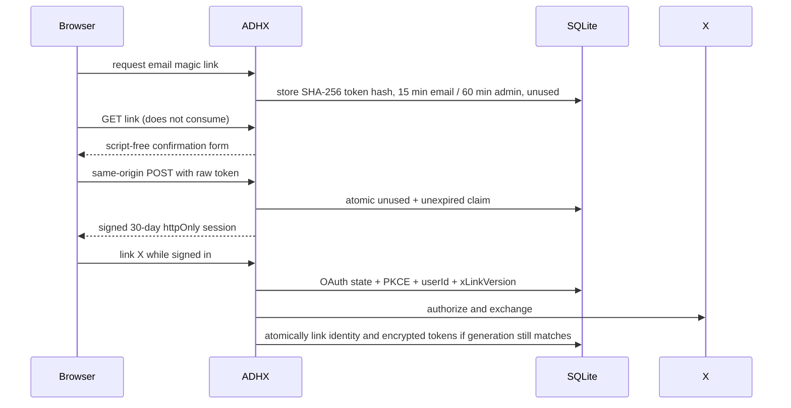
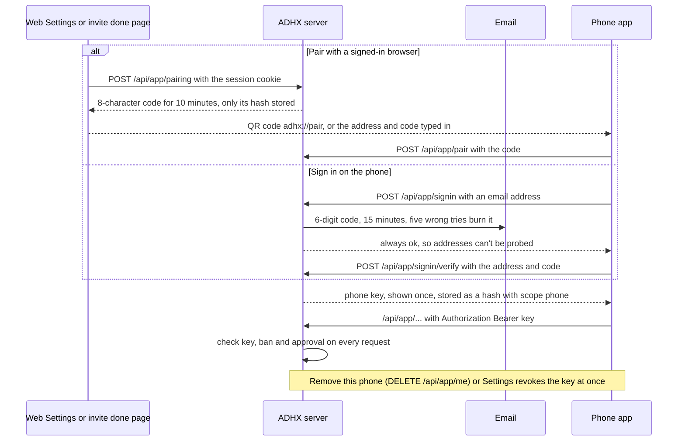
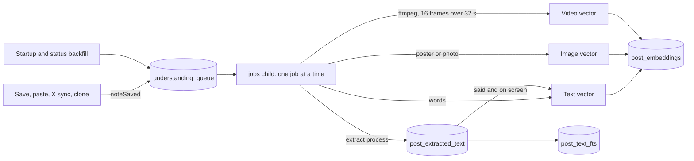
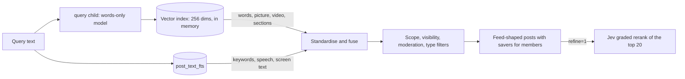

# Architecture

This is the technical tour of ADHX: the shape of the system, how a link
becomes a post you can watch, and the boundaries that keep it private. It's
written for contributors, self-hosters who like to know what's running in
their cupboard, and coding agents. For the rules and gotchas to follow while
changing code, use [`CLAUDE.md`](CLAUDE.md). The per-feature contracts live
in the specs:

- [`docs/specs/friends-feed.md`](docs/specs/friends-feed.md): members, Just for
  me, notes, New, sends, channels, live names, forming bells, Getting it ready.
- [`docs/specs/phone-app.md`](docs/specs/phone-app.md): the `/api/app/*` API
  and the iOS and Android apps.
- [`docs/remote-processing.md`](docs/remote-processing.md): the optional native
  Mac helper and the processing protocol.
- [`docs/specs/translation-safety.md`](docs/specs/translation-safety.md): the
  rendering rule that keeps browser translation from crashing React.

ADHX is one Next.js 16 App Router application running React 19 on Node. The
route handlers are the backend. They use Drizzle over one `better-sqlite3`
connection and a persistent SQLite file; there is no separate API service,
Redis tier or object store. Kept media lives in a folder on the same volume
(`MEDIA_DIR`). The exceptions are the model processes: the web server forks
child processes on the same machine for search-by-meaning inference, because
inference blocks its thread. With `PROCESSING_MODE=remote`, only the
lightweight query child stays there and an optional native Mac helper claims
the heavy work over authenticated HTTPS.

Every diagram below has a short summary under it, so nothing here depends on
seeing the picture.

## Words used here

| Term              | Meaning                                                                                                                       |
| ----------------- | ----------------------------------------------------------------------------------------------------------------------------- |
| **Member**        | A signed-in account that is approved and not banned. Everyone on one server is one group.                                     |
| **Save**          | One person's copy of a post: a `bookmarks` row. Two people saving the same post make two saves.                               |
| **Post key**      | `platform:id`, the post itself, whoever saved it. Downloads and understanding are keyed by post.                              |
| **Just for me**   | A private save (`bookmarks.is_private`). Only its owner sees it.                                                              |
| **Kept**          | A post whose media has been downloaded to the server's `MEDIA_DIR` and is served from there.                                  |
| **Understanding** | Turning a post's words, pictures, video frames, speech and on-screen text into vectors and searchable words.                  |
| **Moment**        | A live group of recent saves about the same thing, shown on Right now.                                                        |
| **Channel**       | A tag, or a group of posts derived from saves (From everyone, Your people, Made for you).                                     |
| **Phone key**     | A secret a paired phone app sends as `Authorization: Bearer`. Stored on the server only as a hash.                            |
| **Worker token**  | `PROCESSING_WORKER_TOKEN`, the machine secret the optional Mac helper uses. Never an account credential.                      |
| **Jev**           | TypeSafe's hosted decision model, used only when `TYPESAFE_API_KEY` is set: it reranks search and names channels and moments. |

## What ADHX is now

ADHX is a self-hosted, private, curated feed across fourteen social networks,
for one group of close friends and family per server. Everyone who can sign in
to a server is one group: a **member** is a signed-in, approved, non-banned
account. Saves are shared with members by default, and any save can be marked
**Just for me**. Every saved post's media is downloaded once and served by the
server itself. Native iOS and Android apps put ADHX in the share sheet and play
the same feed, and an optional native Mac helper takes the heavy processing off
a small NAS.

The privacy rule is **named to friends, never to strangers**: members see who
saved what (and their notes); signed-out visitors only ever see counts, and a
Just for me save is never shown, counted or named to anyone else. See
[Who sees what](#who-sees-what).

The earlier X-first hosted product (the library grid, `TheaterShell`, Discover
at `/live`, `/trending` and `/leaderboard`) is gone. Its URLs redirect, and the
few tables that still carry its data are marked as legacy below.

## System context

In words: browsers and phone apps reach one Next.js server through your
reverse proxy, with a session cookie or a phone key. The server keeps one
SQLite file and a media folder, and forks model processes for search and for
reading speech and on-screen text. An optional Mac helper connects in the same
way with its own machine token. Outbound, the server fetches posts from the
networks, and only if configured talks to the X API, an email service, Jev,
Sentry, and Hugging Face for model weights.

- **Browser.** Sessions are a signed `adhx_session` cookie. The installed PWA
  registers `/share` as an Android share target; iPhones use the native app or
  a Shortcut. The desktop extension only navigates to `/share?url=…`.
- **Phone apps.** They talk only to `/api/app/*` with a phone key
  (`Authorization: Bearer`). See [Phone app API and auth](#phone-app-api-and-auth).
- **Model processes.** `jobs` (full model, nice 10) and `query` (words only)
  are forked by `src/lib/semantic/supervisor.ts`; `jobs` forks a short-lived
  `extract-child.ts` for Whisper and Florence-2. In remote mode `jobs` is not
  started and the Mac does that work.
- **Reverse proxy.** The root Compose example publishes a loopback port for a
  host proxy; [`deploy/nas/`](deploy/nas/README.md) joins an existing proxy
  network and publishes nothing. Neither requires a tunnel; Tailscale is one
  way to keep the server private.

## Product surfaces

Signed in, the primary navigation (`src/components/next/PrimaryNav.tsx`, and
`BottomNav` on phones) has five places:

| Place         | Route                     | What it is                                                                                               |
| ------------- | ------------------------- | -------------------------------------------------------------------------------------------------------- |
| **New**       | `/play?feed=new`          | The blended feed of what your people saved that you haven't seen, with why-reasons; ends on "caught up". |
| **Right now** | `/now`, `/moments/{slug}` | Live moments: recent saves grouped by meaning, forming groups with bells, Tune in (`/play?moment=`).     |
| **Channels**  | `/channels`               | From everyone (group channels), Your people (one per friend), Made for you, and your own tag channels.   |
| **My saves**  | `/play?recent=1`          | Your own saves, newest first.                                                                            |
| **Search**    | `/search`                 | Search by meaning across everyone's saves or yours: words, pictures, frames, speech and on-screen text.  |

Signed-in `/` redirects to New (`src/app/page.tsx`). Everything plays in one
theater, `TheaterV2` at `/play`, whose queue comes from the query: `feed=`,
`recent=1`, `q=`, `channel=`, `auto=`, `group=`, `friend=` or `moment=`.

Other signed-in pages:

| Route                                                | Role                                                                                                       |
| ---------------------------------------------------- | ---------------------------------------------------------------------------------------------------------- |
| `/doing`                                             | What your ADHX is doing: every post being kept, converted, listened to, read or learned.                   |
| `/settings`                                          | You (picture, name, Just for me by default), Your people (invites, approvals), phone app, keys.            |
| `/channels/friend/{username}`                        | A friend's channel (members only).                                                                         |
| `/admin/*`                                           | Admin-role area: overview, people, posts, channels, live, analytics, processing, moderation, invites.      |
| `/start`, `/welcome`                                 | Email sign-in, then a one-shot username choice for new email accounts.                                     |
| `/invite/{token}`, `/invite/done`, `/invite/waiting` | Invite confirmation (a script-free route handler), the "You're in." pairing screen, and the approval wait. |

Public pages (no account needed, never naming savers): the preview pages
(`/{user}/status/{id}`, `/p/{id}`, `/reel(s)/{id}`, `/@{user}/video/{id}`,
`/s/{platform}/{id}`), signed-out `/` (`PublicHome`), `/now` and
`/moments/{slug}` in their anonymous shape, `/play?moment=` and
`/play?channel=`, public channels `/t/{username}/{tag}`, curator hubs
`/t/{username}`, author hubs `/{handle}`, `/privacy`, `/share` and the sitemap.
`src/proxy.ts` turns a full source URL pasted after the host into the clean
preview route.

Retired routes redirect permanently in `next.config.js`: `/live`, `/discover`
and `/trending/*` go to `/now`; `/leaderboard/*` and `/collections/*` go to
`/channels`. `/saved`, `/collection`, `/library` and `/tags` are small redirect
pages.

## Save to watch

In words: every way of saving ends in a `bookmarks` row. That row starts two
background jobs keyed by the post: keep (download once, convert to H.264 if
needed, record the files) and understand (vectors and searchable words). While
a post is still being kept, the player shows "Getting it ready" with real
progress, then plays the kept file. New, Right now, Channels and Search read
the saves and the understanding results.

`POST /api/bookmarks/add` is the platform-neutral save boundary for the web;
`POST /api/app/save` is the phone's, with a durable queue (`phone_save_queue`)
so a share sheet can acknowledge quickly. X delegates over loopback to
`/api/tweets/add` for article, quote, media and link enrichment; the link
networks use `describeNetworkPost` (yt-dlp metadata or link-preview tags), or
reuse an existing retained copy's public metadata. Every save path takes
`private` and `note`, and honours the saver's "Just for me by default".

A save wakes three pieces of background work, each keyed by **post** rather
than saver, so one download and one understanding pass serve everyone who
saved it:

1. **Keep** (`src/lib/keep/`): the download job, the optional H.264
   conversion and the recorded files. See [Kept media](#kept-media).
2. **Understand** (`src/lib/semantic/`): vectors and extracted words. See
   [Understanding pipeline](#understanding-pipeline-search-by-meaning).
3. **Live** (`src/lib/moments/`): the moments engine reads new visible saves
   from `bookmarks` past a watermark. See [Right now](#right-now-live-moments).

**Getting it ready.** When the post on stage is still on its way
(`waiting`, `keeping` or `converting`), the theater asks
`GET /api/activity/processing/posts` (`src/lib/processing/keep-status.ts`)
when the post arrives and every 1.5 s, covers the stage with
`GettingReadyStage` (blurred poster, real percent from the live download or
`keep_jobs.progress`), and plays the moment the copy is kept. Only posts the
viewer may see are answered. **What your ADHX is doing** (`/doing`,
`GET /api/activity/processing`, phone `GET /api/app/doing`) is the full list
with steps, reasons and Retry / Keep the link only for people who saved it.

X bookmark sync is a second ingress (see [X bookmark sync](#x-bookmark-sync));
it is optional and never required to save or watch.

## The theater

`TheaterV2` (`src/components/next/theater/`) plays every queue. Media playback
is the shared `Stage` from `src/components/theater/` (one persistent
`<video>`, the Instagram Range probe, the YouTube iframe); `TheaterV2` drives it
only through window events (`theater-pause`, `theater-resume`,
`theater-set-muted`, …). One persistent `<video>` slot is kept across posts
because mobile browsers grant audible autoplay to the element the user
touched; source generations stop a stale `play()`, `ended` or `error` from
touching the next clip. Posts and articles render on word stages; long ones
are read, not timed.

Preview pages render `PreviewTheater`: the page paints immediately and passes
a not-awaited `sharedResolve` promise for the upstream post, while
`generateMetadata` awaits trusted metadata for crawlers and a Suspense sibling
streams JSON-LD and a semantic static copy. The opened post loops until you
move on; then similar posts from everyone follow, anonymised. A signed-in new
open of a preview autosaves it (`autosave-shared.ts`).

A post counts as seen after 2 seconds on stage or a skip. Seen marks are
batched through an account-scoped local outbox to `POST /api/views` (phones:
`POST /api/app/seen`) and stored in `post_views`.

Watch counts are separate from seen: every player (the web theater's
`useWatchCounts`, iOS `Playback`, Android `PlayerScreen`) counts plays,
finishes and seconds watched by one set of rules (`src/lib/watch/tally.ts`),
keeps unsent tallies in an account-scoped outbox that survives restarts, and
sends them to `POST /api/watched` (phones: `POST /api/app/watched`).
`src/lib/watch/record.ts` adds them to `post_watch_counts`, one row per
member, post and UTC year, only for posts the member can see. They are never
pruned (Wrapped reads a whole year). `src/lib/people/watch-counts.ts` reads a
member's own count on a post, a post's total across members who aren't banned
(no names, only for members who can see it) and a member's year (posts,
hours, most rewatched). Nothing shows them yet. A member's exact counts are
shown only to that member; others get totals without names.

## New: the blended feed

In words: New starts from what other members saved in the last 14 days plus
anything sent to you, removes what you can't see or don't want, scores each
post on four readable signals, applies your Show more and Show less choices,
spreads friends and topics out, puts unseen sends first, and returns a page
where every post says why it's there. Posts you've seen drop out next time.

`src/lib/feed/blend.ts` is pure (signals, `BLEND_WEIGHTS`, variety, why words,
cursor); `blend-db.ts` loads candidates and context. Routes:
`GET /api/feed/blend?mode=new|everyone|friends|mine&types=…` and the phone's
`GET /api/app/feed`; `GET|PUT /api/feed/weights` and `/api/feed/types` (and
their `/api/app/` twins) store Show more / Show less and "What's in your feed"
in `user_preferences` (`feed.weights`, `feed.types`). A bounded `feed.sitting`
record holds the last view and the end of the previous sitting, including
replays; it does not overwrite `post_views.seen_at` (the first view). Existing
libraries use their historical view rows until a sitting is recorded.

- **Candidates.** `new`: posts someone else saved in the last 14 days that you
  haven't seen, plus every unseen send to you however old. `everyone`: all
  visible saves, yours sparingly, reaching back to the newest 300 on a quiet
  server. `friends`: what friends saved that you haven't. `mine`: your newest
  500, not archived.
- **Signals**, each 0–1: `fresh` (decay from the newest other save, 24 h
  scale), `together` (two or more voices), `close` (how much of that friend's
  saves you've watched or saved over 180 days), `like` (cosine to the mean of
  your last 50 saves, ranked within the pool), plus a seeded jitter. There are
  no engagement signals.
- **Why-reasons.** Every item carries `why` and `whyReasons`
  (`sent | together | more | like | close | fresh | yours`), for example
  "Pete sent you this", "Ana and Ben saved this", "Like the frog videos you
  kept", "You watch most of Ben's saves". The `like` reason carries the kept
  post it resembles, for a thumbnail.
- **Snapshots.** The first page fixes the order under a random seed for about
  five minutes (in memory, per viewer); later pages re-read savers, moderation
  and gone posts, plus current unseen senders and notes, so only ordering is cached, never authorization. A weight
  change clears that viewer's snapshots.
- **End states.** `caughtUp` ("You're all caught up. Go touch grass."),
  `nothingYet` (nobody else saved anything in the window) and `waiting`
  (unseen posts the kinds filter held back, "4 text posts waiting").

## Sends

"Send straight to your people" (`src/lib/sends/`, table `post_sends`):
`GET|POST /api/posts/send` and `GET|POST /api/app/send`. The GET lists every
other member with `has` (they have their own save of it) and `sent` (you
already sent it). A post whose only save you can see is your own private one
is not sendable ("Just for you. Share it first to send it."); someone else's
private save is not found. Sends skip people who have it or were already sent
it, accept an optional note cleaned like a save note, and are limited to 60 a
minute.

In New, unseen sends from approved, non-banned senders lead (newest first)
with the reason "Pete sent you this" and the sender's note on their face,
until the recipient sees the post; `markSeen` sets `post_sends.seen_at`.

## Right now: live moments

In words: an engine inside the web process watches new visible saves, joins
each one to a live moment or a forming group, and regroups everything every
five minutes. Browsers and foreground phone screens follow it over server-sent
event streams. Phones reconcile authenticated snapshots on change/reconnect,
with REST fallback on older or offline servers. When a forming group that someone rang the bell on goes live, the
server writes an alert that the web and the phones pick up as a notification.

- **Engine** (`engine.ts`, global state in the web process, running only
  while someone listens and idling after 10 minutes): new saves past a
  watermark wait up to three minutes for their first vector, then join the
  closest moment or a forming group; forming groups become moments with
  `MOMENT_MIN_SAVERS` distinct people (default 3). Every 5 minutes it regroups
  recent saves from scratch over widening windows (24 h, 72 h, 7 d). Moments
  live in memory only. Only visible saves count (`visibleSave`: not private,
  not a quoted copy, saver not banned).
- **Anonymous engine, named per request.** Saver ids never leave the engine
  and its broadcasts. `src/lib/moments/people.ts` adds faces (`savers`,
  `watchers`, forming `people`, `recentSaves`) per request for members only;
  signed-out responses keep the anonymous shape.
- **Watching together.** `presence.ts` counts watchers per account across web
  streams and 15-second phone leases. Members can react (six emoji, or up to
  40 cleaned characters, 20 a minute, 6 of them words); a Live reaction goes
  to the members watching that moment and is also kept on its post (below).
- **Reactions on every post** (`src/lib/reactions/`, `post_reactions`):
  `GET|POST /api/posts/reactions` (web) and `/api/app/reactions` (phone),
  `DELETE …/{id}` for your own. Visible, with names, only to members who can
  see the post (`seenBy`); never from banned members; none on a hidden post
  (moderation read fail-closed). Live reactions are stored with the id the
  room saw. Players replay the newest 12 when a post settles, once per post
  per visit (`useReactionReplay`).
- **Bells and alerts** (`alerts.ts`): `PUT|DELETE
/api/moments/forming/{id}/alert` (phone: `/api/app/live/forming/{id}/alert`)
  stores a bell. Bells follow merges and regroups (`reconcileForming`), fire
  one `moment_alerts` row per subscriber when the group goes live, and vanish
  silently when it dissolves. `GET /api/moments/alerts` (phone
  `/api/app/alerts`) lists unseen alerts from the last 24 hours;
  `POST …/alerts/seen` marks them. On the web, `MomentAlerts` in AppShell
  polls every minute and shows a toast plus a browser notification when
  permission was granted at the bell; iOS polls and schedules a background
  refresh, Android polls and runs a 15-minute WorkManager job, both posting
  local notifications.
- **Names.** Moments and forming groups are named locally from a topic list
  and shared words; with `TYPESAFE_API_KEY` Jev picks among the candidates.

## Channels

A channel is either a tag or a derived group; there is no second channel
system (`src/lib/channels/`, overview in `overview.ts` for both
`GET /api/channels` and `GET /api/app/channels`).

| Kind              | Source                                                                                                      | Who sees it                                                      |
| ----------------- | ----------------------------------------------------------------------------------------------------------- | ---------------------------------------------------------------- |
| **From everyone** | `group_channels`: the server's visible saves clustered and named (at most 8), recomputed in the background. | Members. Reads recheck each post's visible savers.               |
| **Your people**   | One per other member with visible saves (`friends.ts`), with "N new" and their latest note.                 | Members.                                                         |
| **Made for you**  | `auto_channels`: your saves clustered by meaning, per user.                                                 | Only you.                                                        |
| **Your channels** | Tags (`bookmark_tags`), public via `tag_shares.is_public` at `/t/{username}/{tag}`.                         | You; anyone, once you make one public. Never your private saves. |

**Keep this channel** on a From everyone channel
(`POST /api/channels/group/{slug}/keep`, phone
`/api/app/channels/group/{slug}/keep`) saves the posts you don't have from a
member's visible save (`source = 'channel_keep'`, never copying a note), tags
them with the channel's name, and leaves the channel private. Keeping a Made
for you channel (`POST /api/channels/auto/{slug}/keep`) tags your own posts.
Clones of a public channel apply the recipient's Just for me by default.

An independent, off-by-default `TYPESAFE_CHANNEL_IMAGES=on` refinement pass can
improve generated channel display names, borderline membership, repetition
spacing and cover-post selection. `channels/visual.ts` enqueues bounded durable
work during local reads; instrumentation starts one async worker that prepares
existing retained public-post stills and calls the pinned TypeSafe image API.
It never loads a local model or extracts video on the NAS. Cached decisions are
an overlay: original channel slugs, user saves, files and manual channels stay
intact. The shared channel APIs serve web and phone. Visibility/media/policy
fingerprints invalidate stale results; private-only posts, saver identities,
tags, notes and extracted words are excluded from uploads. See
[image-aware channel curation](docs/channel-image-curation.md) for limits,
confidence gates, retries and the evaluation boundary.

## Who sees what

In words: a shared save shows members the post, who saved it, their face,
note and time; signed-out visitors see the post and a count only. A Just for
me save is for its owner alone. Sends are between sender and recipient.
Views, weights, bells and archive belong to one account. Kept files of
shared posts are reachable by anyone who can reach the server. Admins see
counts, never lists of private saves.

The rule is **named to friends, never to strangers**
([`docs/specs/friends-feed.md`](docs/specs/friends-feed.md),
[`PRIVACY.md`](PRIVACY.md)). Saves are shared with the server's members
(signed-in, approved, non-banned accounts). `bookmarks.is_private` marks a save "Just
for me": its owner still searches and plays it, but no one else sees, counts
or is told about it, and it writes no activity pulse (going private also
deletes the owner's earlier `save` pulse rows for it).

- **One condition.** `visibleSave()` / `visibleSaveFilter` is the SQL for "a
  save other people may see or count". Moments, the blend, group and friend
  channels, trending save counts, Everyone
  search (`publishable`), `loadSearchItems`' choice of another saver's copy,
  similar posts, the sitemap, author hubs, the public post JSON and the
  pulse's own-play fallback all use it.
- **Names for members only.** `saversFor(keys, viewerId)` returns savers
  (username, display name, avatar, when, `isYou`) newest first, the viewer's
  own save included even when private; empty for a signed-out viewer.
  `loadSearchItems` attaches `savers` and `isPrivate` when the viewer is
  signed in, so `/api/feed`, `/api/search`, `/api/search/similar`, channel
  queues and the phone's `PhonePost` carry them; nothing public does.
  `listMembers(viewerId)` lists members with the saves the viewer can see.
- **Switching.** Every save path takes `private` (`/api/bookmarks/add`,
  `/api/tweets/add`, `/api/app/save` and its queue); a repeat save with
  `private` updates the flag. `PATCH /api/bookmarks/[id]/private` and
  `POST /api/app/private` switch an existing save.

Privacy changes also invalidate public caches immediately. SQLite triggers in
`bookmarks/visibility-sql.ts` increment a durable `server_settings` revision on
save insertion, deletion or visibility changes; public channels, curator/author
profiles, trending and leaderboards check it even on warm cache hits. This is a
constant-time read and works across web processes. Feed snapshots keep their
original cursor positions, but recheck moderation, savers, explanations and
counts on every page. Active live streams recheck membership and their phone
key before events and on each 20-second heartbeat, closing on revocation.

Both native share sheets can acknowledge a link before their privacy choice is
settled: `deferPublish: true` stages new saves privately, then
`PATCH /api/app/save { id, private? }` durably confirms the current choice.
Changes made while metadata is being fetched are read at completion, in the
same transaction that publishes the save. Closing the extension waits for the
intent request; interrupted acknowledgements are retried from Shared lately.
Android delivery belongs to durable WorkManager and resumes the same receipt.
Both persist a monotonic intent version, so retrying an accepted request with a
lost response cannot undo a newer intent or a later web privacy change.
Without an acknowledgement a new save stays private. Repeat shares preserve
existing privacy unless an explicit choice changes it. Keeping a public
channel applies the recipient's private-by-default setting to new copies.

Join approval requests are anchored to the invite identity on the joining
account. Deleting an inviter removes its invite records without removing
another person's pending request; the admin can still approve or decline it.

**Just for me reaches files too.** `src/lib/keep/file-access.ts` decides who
may fetch `/api/files/{platform}/{id}/{slot}`: a shared post (or a quoted copy)
is served to anyone; a post whose only saves are Just for me only to an owner
(session, phone key, or the post's HMAC file token, which `toPhonePost` and
Shared lately add to the owner's own URLs because phone video players can't
send headers), with `private, no-store`. Anyone else gets the answer for an
unsaved post, and why a file is missing is only told to members. The send
sheet's `has` counts shared saves only; X sync and Keep this channel apply Just
for me by default. **Known exception**, documented in
[`PRIVACY.md`](PRIVACY.md): admin post and member counts include private saves.

## Accounts and authentication

Accounts are created by an invite link (see [Invites and approval](#invites-and-approval))
or an email magic link; email links are also how people sign back in. X is an
optional linked identity used to sync bookmarks; it never creates a session or
account.
`GET /api/auth/me` is the client-side source of truth for the account,
identities, X connection, username state, and persisted admin role.

In words: the browser asks for a sign-in link, and the server stores only a
hash of it. Opening the link shows a confirmation page that spends nothing;
pressing the button posts the token, which the server claims once and answers
with a signed 30-day session. Linking X later runs OAuth with PKCE, bound to
the signed-in account, and only links if nothing changed in between.

Magic-link tokens are single-use and store a hash. Emailed links expire after
15 minutes; admin-held links expire after 60 minutes. Admin delivery separately
retains the raw link until use/expiry so it can be handed over. Requests have a
one-minute resend cooldown per normalized email, based on creation time rather
than token lifetime. GET/HEAD only inspect the link; an explicit same-origin POST
consumes it atomically and sets the session, followed by a 303 redirect. Invalid
or used links show an actionable error, never a silent redirect home. Email identity creation and email
changes claim the unique identity in a transaction so concurrent callbacks
have one winner. `/welcome` only accepts a live, unbanned, signed-in account
that has not already chosen a username.

The `adhx_session` cookie is an HS256 JWT with a 30-day expiry, `httpOnly`,
`sameSite=lax`, and `secure` in production. A valid signature is not sufficient
authorization: `getCurrentUserId()` also requires a live `users` row,
`approval = 'approved'` and a successful, negative ban lookup. A deleted-account JWT or an unavailable
moderation store is treated as signed out.

X OAuth uses PKCE. Each `oauth_state` row is bound to the initiating ADHX
`userId`, has a 10-minute lifetime, captures the account's monotonic
`xLinkVersion`, and is consumed by an owner-and-expiry-conditional delete. A
callback under another session cannot consume it. Disconnect increments the
generation and removes the identity, tokens, and pending states atomically, so
an in-flight callback cannot reconnect behind the user's back. One partial
unique index permits at most one X identity per ADHX account.

OAuth access and refresh tokens are AES-256-GCM encrypted at rest. X refresh
tokens rotate and are single-use, so `getValidTokens()` is the only refresh
entry point:

- a five-minute expiry buffer refreshes before the edge;
- one in-process Promise coalesces same-user requests;
- a 30-second durable SQLite lease prevents another worker spending the same
  token;
- encrypted access/refresh columns, lease ID, linked identity, and generation
  form compare-and-swap guards;
- transient/network/5xx or stale-writer failures retain the current row;
- a fatal 400/401 deletes only the exact leased row X rejected, leaving the
  ADHX session intact.

Account deletion (`DELETE /api/account`) is one transaction. It removes
user-owned content, identities, OAuth material, preferences, tags, aliases,
viewing marks, sends in both directions, bells and alerts, keys, pairing codes,
the phone queue, invites made or used, owner-keyed channel statistics and
picture files and Made for you channels (`auto_channels`); the account's
"saved" pulse rows are deleted and nullable actor IDs in the remaining activity,
analytics and channel-view history are set to null. `admin_audit` stays. Clear
data (`POST /api/account/clear`) removes saves and their per-user state, Made
for you and "saved" pulses, but keeps the account, keys and invites. Removing
one save removes its "saved" pulse. Post-keyed understanding rows (vectors,
queue, keyword row, extracted words) go with the post's last save, by
`AFTER DELETE ON bookmarks` triggers in `src/lib/semantic/schema-sql.ts`. SQLite triggers reject every future insert or account-ID
change that references the deleted `users.id`, closing the race between an
already-authenticated request and deletion commit.

## Invites and approval

Invites are the easy way in (`src/lib/auth/invites.ts`, table `invites`).

1. A member makes a link: `POST /api/invites` (admins always; other members
   when **Who can invite** isn't "Only me"). The link is shown once; only the
   SHA-256 of its token is stored. It works once, for 7 days, and can be
   revoked or reissued (`POST /api/invites/{id}/link` swaps in a fresh token).
2. `GET /invite/{token}` is a script-free route handler ("Ana wants you in.")
   with a name field. Link previews and `HEAD` never spend it.
3. A same-origin `POST /invite/{token}` claims the invite with one conditional
   write and, in the same transaction, creates an account with no email (its
   identity is `('invite', <invite id>)`) and sets the session cookie.
   `ALLOWED_EMAILS` doesn't apply: the invite is the permission.
4. The browser lands on `/invite/done` ("You're in.") with a phone pairing code
   already on screen, or on `/invite/waiting` when approval is needed.

**Who can invite** (`admin | approve | anyone`) is stored in `server_settings`
(`invites.who`) and changed by admins with `PATCH /api/people`; `INVITES=members`
only sets the first default. Under **Anyone, I approve**, someone a non-admin
invited joins with `users.approval = 'pending'`. `getCurrentUserId()`, phone
keys and access keys treat any account that isn't `approved` as signed out;
only `/invite/waiting` and `GET /api/auth/approval` see it. Admins answer under
Settings → Your people → Waiting for you (`POST /api/people/requests/{id}`
with `approve | not_now | decline`; phone `/api/app/people/requests/{id}`),
and every answer is audited. Requests are anchored to the invite identity, so
deleting the inviter doesn't strand them.

Email sign-in is how people get back in on a new browser. `ALLOWED_EMAILS`
limits who may create an account by email; existing accounts can always sign
in. Links go by Resend or SMTP, or (with `EMAIL_LINKS_TO_ADMIN`) wait on the
admin page for an admin to pass on.

## Phone app API and auth

A phone gets its key one of two ways: by pairing with a signed-in browser, or
by signing in with an emailed code, with no browser involved.

In words: to pair, the browser asks the server for a short one-time code and
shows it as a QR code; the phone sends the code back and receives its key.
To sign in on the phone instead, the phone asks for an emailed six-digit code
and sends it back with the address. Either way the server stores only a hash
of the key, checks it with the account's ban and approval state on every
request, and forgets it the moment the phone or Settings removes it.

- **Pairing.** `POST /api/app/pairing` (session) makes a one-time code in
  `app_pair_codes`; a new code cancels the old one. `POST /api/app/pair`
  spends it with one conditional write and returns a phone key: an
  `access_keys` row with scope `phone`, stored as a SHA-256 hash with its last
  four characters, at most 10 per account. Settings lists phones
  (`GET /api/app/phones`) and removes them (`DELETE /api/app/phones/{id}`).
- **Every request.** `phoneCaller` (`src/lib/api/phone-auth.ts`) reads
  `Authorization: Bearer adhx_…`, then refuses banned and not-yet-approved
  accounts. `withPhoneKey` routes take only a key; `withPhoneKeyOrSession`
  routes (channels) also take a session, but a request that brings a key uses
  only the key. Members' pictures (`/api/files/avatar/{hash}`) accept a phone
  key too. Phone keys never authorize the processing protocol, and named live
  streams close when their key is revoked.
- **Routes** (all under `/api/app/`): `me`, `status`, `save` (POST, receipt
  GET, privacy-intent PATCH), `saves`, `search`, `private`, `note`, `send`,
  `feed`, `feed/types`, `feed/weights`, `seen`, `channels`,
  `channels/{kind}/{slug}` and its `keep`, `live`, `live/{slug}` (GET, foreground
  POST lease, DELETE), `live/{slug}/stream`, `live/{slug}/react`,
  `live/forming/{id}/alert`, `alerts`, `alerts/seen`, `people`,
  `people/requests/{id}`, `doing`, `doing/retry`. Shapes are in
  [`docs/specs/phone-app.md`](docs/specs/phone-app.md) and the friends-feed
  spec.
- **Share sheets.** The iOS share extension and Android's share activity post
  to `/api/app/save` with a request id. With `Prefer: respond-async` the save
  goes through `phone_save_queue` (5-second worker, retries over about 13
  minutes, receipts kept 7 days); a retried request id returns the original
  receipt. `deferPublish: true` stages a new save privately until
  `PATCH /api/app/save` confirms the Just for me choice with a monotonic
  `intentVersion`. A link the phone can't deliver waits on the phone (App
  Group queue and background task on iOS, WorkManager on Android).
- **On the phone.** The key lives in the Keychain (iOS) or a Keystore-backed
  encrypted file (Android) and is sent only to the paired server. The apps are
  built from source (see [`apps/ios`](apps/ios/README.md) and
  [`apps/android`](apps/android/README.md)).

## Persistence planes

Drizzle definitions are in `src/lib/db/schema.ts`. Startup
(`src/lib/db/migrate.ts`) applies the historical Drizzle SQL, then raw DDL,
guarded `ALTER`s, `UNDERSTANDING_DDL` (`src/lib/semantic/schema-sql.ts`),
the sends/moments DDL (`src/lib/sends/schema-sql.ts`), the save-visibility
triggers (`src/lib/bookmarks/visibility-sql.ts`) and finally the account
guards. Tables are easier to understand by plane than as one long list.

| Plane                      | Tables                                                                                                                                       | Purpose                                                                                                                                            |
| -------------------------- | -------------------------------------------------------------------------------------------------------------------------------------------- | -------------------------------------------------------------------------------------------------------------------------------------------------- |
| Accounts and sign-in       | `users`, `user_identities`, `username_aliases`, `login_tokens`, `admin_sign_in_links`                                                        | Immutable account IDs, role, approval state, picture; email / X / invite identities; rename redirects; hashed sign-in links; admin-held links.     |
| X connection               | `oauth_state`, `oauth_tokens`                                                                                                                | Bound PKCE state and encrypted rotating credentials with a refresh lease.                                                                          |
| People and server          | `invites`, `server_settings`, `user_preferences`                                                                                             | Hashed invite tokens; Who can invite and other server-wide keys; per-person settings, including `feed.weights` and `feed.types`.                   |
| Saves                      | `bookmarks`, `bookmark_media`, `bookmark_links`, `bookmark_tags`, `archived_posts`                                                           | One save per saver, with `is_private` (Just for me) and `note`; media rows, rich links, tags, private archive state.                               |
| Feed                       | `post_views`, `post_watch_counts`                                                                                                            | Each member's watched list (pruned after 180 days); plays, finishes and seconds per member, post and year (never pruned).                          |
| Sends                      | `post_sends`                                                                                                                                 | Member-to-member sends with an optional note and `seen_at`.                                                                                        |
| Reactions                  | `post_reactions`                                                                                                                             | An emoji or a few words a member left on a post (Live ones too), shown to members who can see the post.                                            |
| Moments and alerts         | `moment_alert_subs`, `moment_alerts`                                                                                                         | Bells on forming groups and the alerts they fire. Moments themselves live in memory.                                                               |
| Channels                   | `tag_shares`, `group_channels`, `auto_channels`                                                                                              | Public/private tag channels; server-wide From everyone channels (no `user_id`); per-person Made for you channels.                                  |
| Phone and keys             | `access_keys`, `app_pair_codes`, `phone_save_queue`                                                                                          | Hashed phone (`phone`) and search (`search`) keys; one-time pairing codes; the share sheet's durable save queue.                                   |
| Sync                       | `sync_logs`                                                                                                                                  | X sync claim, heartbeat, outcome and counts.                                                                                                       |
| Kept media                 | `keep_jobs`, `kept_files`, `keep_settings`, `media_conversions`                                                                              | One download job per post (with progress), the files in `MEDIA_DIR`, the backfill cutoff, leased H.264 conversions.                                |
| Understanding              | `post_embeddings`, `understanding_queue`, `post_extracted_text`, `post_text_fts`, `video_index_state`, `video_segments`, `processing_leases` | Vectors, the work queue, speech and on-screen words, keyword index, sectioned video progress and vectors, remote-worker leases. All keyed by post. |
| Moderation and admin       | `moderated_posts`, `user_bans`, `admin_audit`                                                                                                | Hidden posts, banned accounts, every admin action.                                                                                                 |
| Admin counts               | `reaction_counts`, `moment_log`                                                                                                              | Reactions per member, day and kind (counts only) and the live-moment log (no user ids).                                                            |
| Public pulse and analytics | `activity`, `analytics_events`, `collection_events`, `collection_aggregates`                                                                 | Anonymous post pulse (30 days), private product log (90 days), channel view/clone detail (90 days) and all-time totals. Partly legacy, below.      |
| Bookkeeping                | `migration_state`, `__drizzle_migrations`                                                                                                    | One-time backfill flags and applied SQL migrations.                                                                                                |

Sessions are a signed cookie, so there is no session table. Worker presence
for the Mac helper is in memory. The legacy `collections`, `collection_tweets`
and `sync_state` tables are dropped at every start, `read_status` was renamed
to `archived_posts`, and `bookmarks_fts` was replaced by `post_text_fts`.
`users.last_seen_at` (at most every 5 minutes, from sessions and phone keys),
`access_keys.platform` (`ios`/`android` when a phone's requests say) and the
`server_settings` key `processing.paused` (Pause new work) feed the admin area;
see the [admin specification](docs/specs/admin.md).

The main isolation key for saves is `(userId, platform, sourceId)`.
`bookmarks` uses `(userId, platform, id)`; media, tags, links and archive rows
carry the same owner and platform. Two people can save the same post
independently, and a numeric TikTok ID can't collide with a tweet ID. Every
user-data query filters by `userId`; every bookmark-child lookup also filters
by `platform`. Reading other people's saves goes through one condition,
`visibleSave` (see [Who sees what](#who-sees-what)). Keep, understanding,
`group_channels` and the moments engine are keyed by post or server, never by
saver.

`bookmark_links` has a unique `(userId, platform, bookmarkId, expandedUrl)`
boundary. Manual save and sync both use field-wise upserts: null or sparse
enrichment cannot erase an existing article body, image, title or
description, and concurrent complementary writes converge.

**Account guards.** `src/lib/db/account-invariants.ts` installs idempotent
SQLite triggers on 28 user-linked tables (`auto_channels` included): every
insert, or change of account ID, must reference a live `users` row. This
closes the race where a request authenticated before `DELETE /api/account`
writes after the deletion commits. `group_channels` is not guarded (it has no
user column; its saver counts are rechecked on read).

**Visibility revision.** Triggers from `bookmarks/visibility-sql.ts` bump a
durable `server_settings` counter on every save insert, delete or privacy
change. Public caches compare it on every read, including warm hits in other
web processes.

SQLite runs in WAL mode with foreign keys on. Container startup migrates
before the server listens and stops on a failed security- or
integrity-critical step. Local development does not migrate automatically:
run `pnpm db:migrate` before `pnpm dev`.

## X bookmark sync

`GET /api/sync` is an authenticated SSE stream. Before opening it, the route
checks the configurable cooldown (one hour by default), confirms X credentials,
and atomically claims a `sync_logs.status = 'running'` row. A partial unique
index permits one running sync per user across processes. A second connection
observes that run through user-scoped persisted counters and its terminal result;
closing an observer does not cancel the owner. Settings' Sync card and `/start`
(`useXSync`) attach to a sync that is already running instead of starting a
second one. An automatic sync runs about hourly for people who connected X and
left it on.

The stream renews `heartbeat_at` and emits an SSE ping every 10 seconds. A
claim with no heartbeat for 30 minutes is reaped as failed. Completion and
failure updates include `(userId, syncId, status='running')`, so a stale worker
cannot overwrite a reaper or replacement owner. Loss of lease stops processing;
client disconnect marks the owned run failed.

Every sync pages through X bookmarks, requesting up to 100 at a time until X
omits its next-page token. Short, empty, and duplicate-only pages do not end the
scan. Legacy `all`/`maxPages` query flags are ignored, including from cached
clients. Repeated pagination tokens fail the run instead of looping or claiming
completion. This imports everything X exposes, not posts absent from its API.
The bookmark insert result—not a stale preloaded ID set—is authoritative for “new” counts, analytics, client events, and public
pulses. At most the freshest 25 new rows from one sync enter the public pulse,
so a first-time backfill cannot flood it. A Just for me save writes no pulse.

## Kept media

Every saved post's media is downloaded once and served by ADHX itself (`src/lib/keep`):

- **Queue.** `keep_jobs` holds one row per post (not per saver). The in-process worker (`startKeeping`, started from `instrumentation.ts`) scans for saved posts without a job every 30 s and runs `KEEP_CONCURRENCY` jobs at a time, newest save first. Failures back off (1 min → 24 h), then the job is marked `unavailable`. Saves wake it immediately. With backfill disabled, `keep_settings.backfill_cutoff` persists the activation boundary across restarts; enabling backfill clears it.
- **Download.** X uses fxtwitter's original files (photos `name=orig`, the best MP4 variant, up to 4K), and yt-dlp when fxtwitter can't read the post. A video X took down after a copyright claim (403 `"Dmcaed"` from video.twimg.com) is skipped and never retried; the rest of the post is kept, and the media proxies answer 410 with that reason. Instagram uses yt-dlp, then instafix images and the public mirror. Everything else uses yt-dlp (`-S res,fps,vcodec:h264`), with the page's `og:image` for picture posts. Special cases: Vimeo goes through `player.vimeo.com`; Reddit finds its v.redd.it playlist through vxreddit; Threads only uses link-preview tags. Optional `YTDLP_COOKIES` (a signed-in browser's cookies.txt) is copied privately per yt-dlp run, for posts networks only show to signed-in accounts; without it those saves are kept bare (a TikTok the mirror can't see is described by yt-dlp, or saved by id when TikTok answers "log in") and their download reports the sign-in instead of keeping a preview image.
- **Re-encoding.** Non-H.264 video is re-encoded to H.264 at the same size (CRF 20) unless `KEEP_H264=off`.
- **Recording.** Files land in a scratch folder, are probed with ffmpeg, then moved into `MEDIA_DIR/{platform}/{id}-{hash}/` as slots `video-N`, `photo-N`, `audio-N` and `poster`. `kept_files` records each one. In the same transaction, `reconcileKeptMedia` updates each saver's public category/media descriptors to the actual file kinds and counts, preserving private tags, archive state and summaries. Article categories stay articles.
- **Serving.** `/api/files/{platform}/{id}/{slot}` serves the kept file with Range support. `poster` falls back to `photo-1`, and `video-1` to `audio-1`. Until a file is kept, X, Instagram and TikTok hand off (307, relative) to the old proxies; other networks wait up to 25 s for a running download. Every client media URL is built by `keptSrc()` (`src/lib/keep/src.ts`). The route checks moderation, and asks `src/lib/keep/file-access.ts` who may fetch: anyone who can reach the server and knows a post's platform and source ID can fetch the kept files of a shared post, while a post whose only saves are Just for me is served only to an owner (see [Who sees what](#who-sees-what)).
- **Progress.** `keep_jobs.progress` holds the last download percent (in steps of 5) so Getting it ready and `/doing` survive restarts; in remote mode a post stays `converting` until every `media_conversions` slot is done.
- **Clean-up.** An hourly pass deletes files for posts nobody has saved any more.
- **Understanding.** The understanding worker reads kept files straight from disk. Its content hash gains `:kept` once a file is kept, so posts are learned again from the original.

### Link networks

YouTube, Facebook, Reddit, LinkedIn, Vimeo, SoundCloud, Pinterest, Twitch, Threads, Imgur and Bluesky live in `src/lib/platform/networks.ts`:

- **Recognising links.** That file holds link detection, canonical links and labels. `detectPlatformPost` falls through to it.
- **Saving.** `/api/bookmarks/add` first reuses public metadata and file counts from an existing retained copy (`retainedDescription`, excluding hidden posts and banned savers). Otherwise it calls `describeNetworkPost`: yt-dlp metadata, or link-preview tags for picture posts. It stores a fresh per-user save and one media row per file; it never copies another user's tags, summary or archive state.
- **Previews.** Preview pages are `/s/{network}/{id}`, with `?by=author` where the network needs it.
- **Short links.** `/api/links/resolve` follows short share links.

## Understanding pipeline (search by meaning)

`src/lib/semantic/` turns every save into vectors that power search by
meaning. It runs EmbeddingGemma 2 on the server (text q4 + vision q8; its
audio encoder is not loaded) through `@huggingface/transformers` on
`onnxruntime-node`. What's said in a video (Whisper base) and text on its
pictures and frames (Florence-2 base) are read into words on the server too,
and join the post's words. The following diagram describes local processing;
remote Mac processing uses the length-aware segment plans described below.

In words: saves and a startup backfill fill a durable queue. One background
process works through it a job at a time, making a vector each for a post's
words, its picture and sampled video frames. A separate short-lived process
turns speech and on-screen text into words, which join the post's words and
the keyword index.

- **Keyed by post, not saver.** Only public post content is read (never tags
  or who saved it), so one row serves everyone who saved the post. Per-user
  reads join `bookmarks`, which is the isolation boundary.
- **Durable priority queue.** Fresh saves and Up next jump the line; within a
  priority, words run first, then pictures, speech, text on screen and videos,
  so cheap results land first. Failures back off and give up after three attempts; Retry re-queues.
- **Local child processes.** ONNX inference is synchronous on its thread; run
  inside the web server, one video froze every request for ~15 s. So
  `supervisor.ts` forks `child.ts` twice (`node --import tsx`, which is why the
  image ships `tsconfig.json`): `jobs` runs the worker with the full model at
  nice 10, and `query` holds a words-only copy (~600MB, ~60 ms per query) so a
  search never waits behind a video. Both restart with backoff; children exit
  when the parent goes away. The web server talks to them over IPC (wake,
  current activity, query vectors) and never loads the model.
- **Pacing.** The jobs child shares the CPU with the web server, so it runs one
  job at a time and rests about half the last run's duration between jobs (the
  pattern pond uses). Model weights download once to `SEMANTIC_CACHE_DIR` on
  the volume.
- **Speech and text on screen.** `speech` and `screen` jobs write words, not
  vectors, to `post_extracted_text` (keyed by post; removed with the last
  save). The jobs child prepares the media with ffmpeg (mono 16 kHz samples of
  the first ten minutes; up to four pictures and four frames from the first
  minute) and hands it to a separate extract process (`extract-child.ts`) that
  holds one model at a time and exits after a minute idle, so its 1.5–1.8 GB
  goes back to the system. Junk (silence, music, invented outro lines, stray
  marks) is filtered in `extract-clean.ts`. New words rewrite the keyword row
  and re-queue only that post's `text` vector: its text hash includes them.
  Search names these matches `speech` / `screen` ("Said in the video", "On
  screen") when the query's words are found there, and Jev (which never gets
  these words) keeps their fused rank like a visual match.
  `SEMANTIC_SPEECH=off` / `SEMANTIC_SCREEN_TEXT=off` stop new work.
- **Media.** Pictures come from the app's own proxies over loopback or from
  allowlisted X CDN hosts; anything else is skipped. Video frames are
  sampled by a maintained system FFmpeg reading the Range-capable video proxy.
  `FFMPEG_PATH` selects an operator-managed binary; Docker uses Debian FFmpeg.
- **Status.** `/api/understanding/status` reports words / photos / videos
  progress for the signed-in user. "Photos" includes video posters, so every
  visual save shows progress after its quick picture pass. The item being worked on is only shown when
  it is one of that user's own saves.

### Optional native Mac processing

For topology, phone-save flow, lease/checkpoint and media-lifecycle diagrams,
see [How NAS and Mac processing work](docs/remote-processing.md). Installation
is covered by the [Mac setup guide](deploy/mac/README.md).

`PROCESSING_MODE=remote` disables the local jobs child, retaining the query
child and keyword indexing. The native ARM64 macOS runner uses the same pinned
model with CoreML MLProgram/CPU fallback, plus VideoToolbox/software video decoding.
On processing protocol 2 it also takes `speech` and `screen` jobs and returns
only the cleaned words (`extracted`); protocol 1 workers are still served and
never handed those kinds.
It never mounts SQLite or opens an inbound port. A dedicated random machine
credential authenticates `/api/processing/jobs` and lease-scoped retained-media
transfers through `/api/processing/media`; account/phone tokens are not accepted.
The machine credential grants instance-wide processing access and belongs only
on trusted private hosts. `SEMANTIC_SEARCH=off` pauses indexing claims/results while conversion can continue;
`KEEP_MEDIA=off` pauses new conversion claims separately.

`processing_leases` provides expiring, heartbeat-renewed claims. Only the current
lease and content/model/profile generation can checkpoint a result. A server-only
source fingerprint is rechecked inside result transactions after asynchronous reads. The NAS
commits results and queue changes in one transaction. `video_index_state` and
`video_segments` checkpoint each section, so a restart resumes at the next one.
Unfinished sections return to backfill priority, allowing fresh shares to jump
the line. Removing the last saver deletes these derived rows and leases.

Remote videos use `INDEXING_LEVEL=light|normal|deep`: target section lengths of
120/60/30 seconds and sample spacing of 12/4/2 seconds respectively. Sections
uniformly cover the entire duration with at most 16 frames each, capped at 512
sections and 24 hours. Segment vectors are searched independently with the best
section contributing one vote per post, subject to existing account/moderation
filters. A final aggregate remains available for channels and similarity.
Changing detail invalidates only remote video generations, not text/image vectors.

The Mac keeps an unfinished video's private downloaded copy between sections.
A final acknowledged result deletes it; section frames always clean up in
`finally`. Scratch originals, partial downloads and frames share an 8 GiB default
ceiling. Startup and periodic sweeps expire abandoned scratch after one hour and
originals after 24 hours; budget pressure can evict sooner. Model weights remain
cached separately. The NAS retains downloads and cheap metadata probes.

In remote mode `recordKept` queues non-H.264 videos in `media_conversions`
instead of encoding on the NAS, and holds the post in a durable `converting`
state until every required slot finishes. Conversion claims take priority over
inference and use independent heartbeat-renewed leases. `KEEP_H264=off` skips
conversion and permits source codecs, as in local mode. Failed conversion never
re-downloads the source automatically.

The native worker encodes full-resolution H.264/yuv420p and AAC using VideoToolbox,
with a bounded two-thread software fallback. It streams the converted file to
`PUT /api/processing/result` under its lease. The NAS limits uploads to 4 GiB,
streams to a separate private scratch directory (8 GiB total, two concurrent
uploads), preserves its free-space reserve and enforces idle/overall deadlines.
A restricted MP4 metadata probe checks codec, dimensions, duration and audio;
then a unique immutable filename is promoted with a transactional per-slot
metadata swap. The original is removed only after commit. Changed/deleted or
moderated sources cannot accept late uploads. Crash leftovers have expiry and
reference-aware cleanup. Mac converted files always clean up after an attempt;
downloaded sources are removed on acknowledgement or expired capability, otherwise
bounded for retry. See [`deploy/mac/README.md`](deploy/mac/README.md).

## Search by meaning

`GET /api/search` finds saved posts by what they mean, show, or say.

In words: the query is turned into a vector by the small query process and
compared with every post's word, picture and video vectors, while the keyword
index matches the words themselves (including speech and on-screen text). The
lists are standardised and fused, filtered by scope, visibility and
moderation, and returned as posts. An optional second request asks Jev to
rerank the top 20.

- **Hybrid signals.** One query vector is compared with every post's words,
  picture and video; keywords come from FTS5 over the same post text. Each
  vector list is turned into z-scores against that query's similarity to all
  candidates of its kind, so a picture match counts only when it stands out.
  On the labelled queries this beat reciprocal-rank fusion by a wide margin
  (hit@5 0.84 vs 0.35) and words alone (0.80).
- **Scale.** The index keeps the first 256 of 768 Matryoshka dimensions
  (~1KB per post per kind) and re-scores candidates with the full vectors
  from SQLite. A linear scan stays in the tens of milliseconds into the
  hundreds of thousands of posts; beyond that it would need an ANN index.
- **Scopes.** `mine` scans only the viewer's saves. `everyone` covers
  everyone's saves: a post needs at least one visible save (`visibleSave` in
  `src/lib/people/savers.ts`: not private, not a quoted copy, saver not
  banned) or the viewer's own, and must not be moderated. Other savers'
  copies are anonymised (no tags, archive state, summary, save time or link
  owner) and never taken from a private save.

- **Refine.** An optional second request reranks the first 20 with Jev
  (TypeSafe), sending only the query and public post words. Jev reads text,
  so visual matches keep more of their fused rank. With it hit@1 rose from
  0.58 to 0.77 on the labelled queries; any failure keeps the fused order.

## Public pulse and analytics (partly legacy)

These are intentionally separate logs with different privacy contracts. They
were built for the earlier public discovery pages (Discover, Trending and the
playlist leaderboard), which are retired; the logs and their JSON endpoints
remain, and nothing in them names a saver.

### Public post activity

`recordActivity()` appends server-resolved `preview`, `save`, and `share`
signals to `activity`. Public clients may submit identifiers only; display
text, authors, images, type, and URLs are resolved or copied from trusted
server state. `userId` may be stored for abuse controls but is never selected
by a public read.

`getTrendingItems()` is the publication choke point used by the signed-out
home's crawlable list and the admin-only `/api/activity` and `/api/trending`
(GET `/api/analytics` is admin-only too, via `src/lib/admin/only.ts`). It explicitly
shapes public columns, enriches saved posts, removes hidden/banned sources,
and deduplicates to one row per `platform:bookmarkId`. Bots and unfurl
crawlers do not write preview pulses. Archive and Just for me saves never
write one. Rows older than 30 days are pruned at startup.

### Private product analytics

`analytics_events` records allowlisted dimensions for post view/save/share,
send/copy/open/tag/archive, auth, sync, shortcut, theater, and playlist events.
Free-form client display data is not accepted. Post events require a canonical
platform and ID, and their content type is server-resolved. Public aggregate
rollups never select `userId`; the admin area (`src/lib/admin/boards/*`)
counts them without ever showing who. Admin-only events: `app.open` (after
30 minutes away, with the client), `search.found`/`search.none` (mode only,
never the words), `post.finish`, and `channel.play`/`channel.keep` for shared
channels.
Rows older than 90 days are pruned during startup migration. Writes are
best-effort so measurement failure cannot fail the user action.

### Channel views (Top channels)

`collection_events` records public-channel `view` and `clone` events, read
by Top channels and `/api/collections/trending`. Self
events do not count; signed-in viewers dedupe for 30 minutes and anonymous
views for 60 seconds. `viewerId` is write-only private data and is never
selected by `src/lib/discovery/rank.ts`.

The score is `views + 5 × clones`. Finite windows read 90 days of retained raw
detail. `collection_aggregates` is updated atomically with every accepted event
and preserves all-time totals without viewer identifiers or an unbounded event
scan. A playlist made private immediately becomes ineligible at read time.
Raw events older than 90 days are pruned at startup and by an hourly,
process-local maintenance pass outside the event-write transaction.
The [leaderboard specification](docs/specs/discovery-leaderboards.md) is
history for the retired page; the ranking rules still apply.

## Moderation fails closed

Moderation reads return either a typed successful result or “store
unavailable”; unavailable is never translated to visible/not-banned. The same
rule applies on cached and uncached paths.

- Hidden posts are tombstoned and noindexed on preview pages, their kept
  files are not served, and they are left out of New, Right now, Everyone
  search, author hubs, sends, public APIs and the sitemap, while
  remaining in owners' own saves.
- Banned accounts lose authenticated access (sessions, phone keys and
  access keys), are never counted or named as savers, and are withheld from
  curator hubs, public channels, Top channels, sitemap entries and sign-in
  completion. Their invites stop working.
- Channel hiding updates raw ranking detail and durable aggregates.
- Post hide/unhide updates `moderated_posts`, matching `activity.hidden`, and
  `admin_audit` in one transaction.
- Public cache hits re-read moderation and compare a moderation fingerprint
  before serving. Failures are non-cacheable.

Admin authorization is `users.role = 'admin'` on immutable account IDs, never
a runtime username allowlist. The admin area (`/admin/*`, `src/lib/admin/`)
counts Just for me saves but builds every list from shared saves only
(`visibleSave`), and never shows what anyone searched or watched. Startup verifies required moderation storage and
terminates if it cannot enforce this boundary.

## Media and outbound-network boundaries

Playback adapters for posts nobody has saved yet (previews) and for saves still downloading reflect what each platform safely exposes:

| Platform  | Metadata                                                               | Playback/download                                                                                                            |
| --------- | ---------------------------------------------------------------------- | ---------------------------------------------------------------------------------------------------------------------------- |
| X         | FxTwitter; X API only for the owner's bookmark sync                    | Range-aware MP4/image proxy over allowlisted `twimg.com`; HLS routes remain for long streams.                                |
| Instagram | Crawler Relay payload (ordered image/carousel media), with OG fallback | Images and Reels use signed-CDN proxies; Reels resolve Relay MP4 URLs first, then the mirror, with official iframe fallback. |
| TikTok    | tnktok/fxTikTok metadata                                               | Proxy follows the mirror's signed redirect to allowlisted TikTok CDN hosts.                                                  |

User-controlled media parameters are validated before interpolation. Media
URLs require HTTPS and exact hosts or dot-prefixed suffix matches—never
substring matching. Redirects are followed manually, every hop is rebuilt and
revalidated, and chains are capped. Arbitrary external OG enrichment uses
public-IP validation and connection-time DNS pinning across redirects to block
DNS rebinding and private-network access.

External work cannot occupy the single process indefinitely. Requests have
deadlines; retrying resolvers share an overall budget; redirects and parsed
bodies have hard limits; and chunked responses are counted as they stream.
Pass-through MP4 responses preserve Range semantics instead of buffering the
file in memory. Inline previews, attachment downloads, public reads, and
analytics writes use separate rate budgets. Exact limits live next to each
route, using `src/lib/rate-limit.ts`.

## Bounded in-process state and scaling envelope

The supported hosting topology uses one application instance and one mounted
SQLite volume per environment. This makes process-local burst controls
accurate and keeps SQLite ownership simple.

Rate limiters have bounded IP buckets and fail closed for unseen keys when
capacity is full. Hot-query, media, and negative-result caches are TTL/LRU
bounded rather than raw maps. Positive public cache hits still recheck
moderation before serving.

In short: SQLite is the database, the job queue and the lock service, and it's
very good at all three as long as there's exactly one of you. Scaling to
multiple application machines would require, at minimum, a shared
rate-limit store and an explicit database/volume strategy. The OAuth refresh
lease and sync claim already use durable SQLite rows and remain cross-process
safe, but process-local caches and browser-facing freshness are optimizations,
not distributed coherence mechanisms.

## Error reporting and privacy

Sentry is server-side only and enabled in production when a DSN is configured.
Releases and environments are tagged; traces are sampled at 20%.
`sendDefaultPii` is disabled.

Both explicit captures and SDK-generated events pass through bounded
sanitizers. Secrets, cookies, authorization data, query strings, request
headers, tokens, PKCE material, and email addresses are removed. User/account/
viewer IDs, usernames, and IP-like identifiers are HMAC-pseudonymized with a
deployment secret. URLs lose query strings, strings are capped, and recursive
contexts have depth/entry/node ceilings. Analytics metrics carry allowlisted
dimensions rather than raw user IDs.

## Extension and PWA

The Manifest V3 desktop extension is a navigation adapter, not another client
of the API. Toolbar, context-menu, and keyboard actions read the selected or
active supported URL and navigate the tab to `/share?url=…`. It has
`activeTab` and `contextMenus`, no `<all_urls>`, no content scripts, no token
storage, and no passive browsing collection. Chromium and Firefox artifacts
are built and manifest-validated in CI.

The web manifest registers `/share` as a GET Web Share Target and captures
`url`, `text`, and `title` because native apps disagree about where they put a
link. `/share` extracts the first supported URL, marks share intent, and routes
to the same preview pages; TikTok short links use a hard navigation through
the server resolver. The service worker exists only to satisfy installability:
its fetch handler never calls `respondWith`, so it provides no offline cache
and cannot serve stale application data.

The native apps are the main phone path (see
[Phone app API and auth](#phone-app-api-and-auth)). Without them, iPhones can use
a Share Sheet shortcut (Safari does not support Web Share Target) and Android
the installed PWA. Browser ingress converges on the preview pages and
`/api/bookmarks/add`; the apps use `/api/app/save`.

## Rendering, SEO, and runtime SQLite

Public pages combine visual UI with semantic server output: preview metadata,
JSON-LD (`SocialMediaPosting` or `VideoObject`), public tweet JSON, author and
curator hubs, public channel `CollectionPage` lists, and a dynamic sitemap.
None of them name savers.
Public APIs and preview metadata recheck moderation and avoid caching a
transient upstream miss as a durable publication decision.

The SQLite file is migrated only when the container starts. It is absent or
table-less during `next build`, so every DB-reading public surface must remain
runtime-rendered: `/`, `/now`, `/moments/{slug}`, preview pages, public
channels, curator/author hubs, `/admin` and `/sitemap.xml` use
`force-dynamic` where Next could otherwise prerender them.
Do not add `generateStaticParams` or convert these pages to static generation;
doing so either fails the build or bakes empty database output into HTML.

Browser translation remains enabled. React trees must follow the sibling text
node rule in the [translation-safety specification](docs/specs/translation-safety.md)
to avoid DOM ownership crashes after a translator inserts wrappers.

## Build, CI, and deployment

The Docker image uses the repository-pinned package manager and frozen
lockfile, produces Next's standalone output, and runs as a non-root user.
Container startup migrates SQLite before starting the application.

CI checks source quality, unit and browser behavior, the production build, both
extension targets, and the runnable container (including migrations and the
health endpoint).

The Native apps workflow builds and tests the iOS and Android apps on every
pull request, and CodeQL scans the code.

Release Please creates a tagged release and then calls three publishers: the
container publisher (AMD64 and ARM64 images for `ghcr.io/itsmemeworks/adhx`),
the Android workflow (a signed APK attached to the release) and the iOS
workflow (a signed upload to TestFlight). The two phone jobs skip with a
notice until their signing secrets exist. Installing a release on a server is
a separate, explicit step; see [`docs/releasing.md`](docs/releasing.md). The
product site and the legacy hosted Fly apps deploy only when run by hand.

Every environment variable is described in [`.env.example`](.env.example);
installation, upgrades and backups are in the
[NAS guide](deploy/nas/README.md).

### Portable Docker hosting

The root Compose example exposes a loopback port for a host-based HTTPS proxy;
`deploy/nas/` is a vendor-neutral bind-mount example on an existing proxy
network, with no host port or public tunnel. Both explicitly pass media/search
controls and include restart and database-health settings. The deployment guide
covers permissions, private access, resource sizing and consistent backups.
Kept-file URLs of shared posts and shared previews are intentionally
unauthenticated; source post IDs are predictable, so network privacy must be
selected by the operator. Files of Just for me-only posts are owner-only (see
Who sees what).

## Friends-feed reliability

Foreground Live uses SSE on web and phones, with snapshot recovery on reconnect.
Streams are bounded in output and lifetime and stop when hidden/backgrounded.
Phones also renew a 15-second presence lease through snapshot requests and leave
explicitly on dismissal/background. Presence is counted by account across web
streams and phones, checked against active credentials, and named only for
members. A bounded known-post list refreshes saver metadata and removes posts
the server no longer considers visible without losing older playable entries.
Reaction drafts remain attached to their original post until acknowledged;
failed sends keep the words and offer Retry. Live reactions are also kept on
their post (`post_reactions`) and replay later for members who can see it.
See [Live updates and presence](docs/realtime.md) for transports, packages,
reconnection grace, polling boundaries and the single-process scaling limit.

The Doing summary counts the complete visible queue in SQLite; filters and
status priority apply before the 60-row display limit. Summary-only requests
skip media and face hydration. Web consumers share a foreground poll per account
and scope, abort it on navigation, and show stale/error recovery explicitly.
Viewing marks use an account-scoped local outbox, removing entries only after a
successful response and retrying on reconnect. See the
[friends-feed verification guide](docs/rollout/friends-feed-verification.md).
