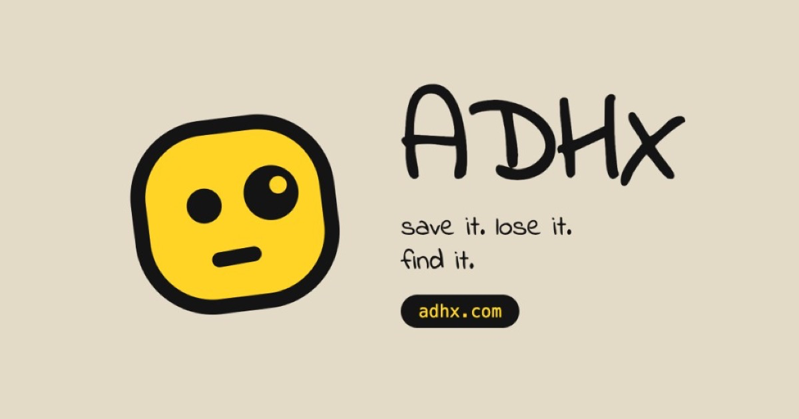

# ADHX

[](https://github.com/itsmemeworks/adhx/actions/workflows/ci.yml)
[](https://github.com/itsmemeworks/adhx/actions/workflows/release-please.yml)
[](https://opensource.org/licenses/MIT)

> **Save it. Lose it. Find it.** On your own server.

ADHX keeps the posts you love from X, Instagram, TikTok, YouTube, Reddit and nine more networks. It downloads each post's video, pictures and sound in the best quality the network offers. It stores them on your own server and plays them from there. Find any of them later by describing what you remember, like "the video with the frog".

It's built to run for yourself and a few friends: one Docker container, one folder of data. ADHX isn't a hosted service. Posts can't disappear behind a deleted account or a dead link, because the files are yours.

<p align="center">
  
</p>

## What you get

- **Your own copies.** Every save is downloaded once, at the highest resolution available (4K from X when the post has it), and served by ADHX. Nothing is streamed from the networks at watch time.
- **Fourteen networks.** X, Instagram, TikTok, YouTube, Facebook, Reddit, LinkedIn, Vimeo, SoundCloud, Pinterest, Twitch clips, Threads, Imgur and Bluesky. The list matches what [linktokeep.com](https://linktokeep.com) supports, plus Bluesky.
- **Search by meaning.** Describe what you remember and ADHX finds it. It matches the words, what's in the pictures, and what happens in the videos (a frame every 2 seconds). This all runs on your server: no audio is processed, and nothing is sent to an AI service unless you add the optional search refinement key.
- **A full-screen player.** Your saves play one after another, newest first, with search, channels and a share button.
- **Channels.** ADHX groups your saves by what they're about and names the groups. You can make your own channels too, and share them.
- **Right now.** See what the people on your server are saving, grouped into moments, and **Tune in** to watch along. Savers are only ever counted, never named.
- **X bookmarks, automatically.** Connect X once. Anything you bookmark there shows up in ADHX within the hour.
- **Search from Claude.** Make an access key and the [adhx skill](#search-from-claude) can find things in your saves for you.

## Supported networks

| Network    | What ADHX keeps                          | Good to know                                                                    |
| ---------- | ---------------------------------------- | ------------------------------------------------------------------------------- |
| X          | Video (up to 4K), photos, text, Articles | Bookmarks can sync automatically                                                |
| Instagram  | Reels, photos and carousels              | Instagram sometimes asks servers to log in; ADHX falls back to public mirrors   |
| TikTok     | Video                                    | Photo posts keep their cover picture                                            |
| YouTube    | Video, Shorts                            | 4K is kept when the upload has it (see [Video formats](#video-formats))         |
| Facebook   | Videos and Reels                         |                                                                                 |
| Reddit     | Video with sound, pictures, text         | Reddit blocks servers from its own pages; ADHX finds the video through vxreddit |
| LinkedIn   | Video and pictures from public posts     |                                                                                 |
| Vimeo      | Video                                    | Videos protected with DRM can't be kept; ADHX keeps their picture and link      |
| SoundCloud | The track and its artwork                | Plays in the same player, artwork on screen                                     |
| Pinterest  | Video Pins and picture Pins              |                                                                                 |
| Twitch     | Clips                                    |                                                                                 |
| Threads    | Text and the post's picture              | Threads only shares a preview-sized picture without logging in                  |
| Imgur      | Images and albums                        | Imgur blocks the UK; a server there can't keep Imgur posts                      |
| Bluesky    | Video and pictures                       |                                                                                 |

Downloads run through [yt-dlp](https://github.com/yt-dlp/yt-dlp), plus each network's public link-preview data for picture posts. ADHX never asks for your passwords on any of these networks.

## Run your own

You need:

- **Somewhere to run a container** with a persistent folder: a home server, a NAS, a small VPS, or [Fly.io](#flyio).
- **A [Resend](https://resend.com) account** to send sign-in emails. ADHX has no passwords; people sign in with a link sent to their email. The free tier is plenty for a group of friends.
- **Disk space.** See [Disk space](#disk-space).

### Docker Compose

```bash
git clone https://github.com/itsmemeworks/adhx && cd adhx
export SESSION_SECRET=$(openssl rand -base64 32)
export RESEND_API_KEY=re_your_key
export EMAIL_FROM='ADHX <login@your-verified-domain.example>'
export NEXT_PUBLIC_APP_URL=https://adhx.your-domain.example
export ALLOWED_EMAILS='you@example.com, @your-family.example'
docker compose up -d
```

ADHX listens on port 3000. Put it behind your usual reverse proxy for HTTPS; sign-in needs HTTPS outside `localhost`. The [`docker-compose.yml`](docker-compose.yml) keeps everything in one volume mounted at `/data`: the database, the search model and every kept file. Migrations run on start.

To pin a release, set `ADHX_IMAGE=ghcr.io/itsmemeworks/adhx:<version>`. You can also build the image yourself with `docker build -t adhx .`.

### Who can sign up

By default, anyone who can reach your server can make an account. For a private group, set `ALLOWED_EMAILS` to a comma-separated list of emails and/or `@domain` entries. Everyone else gets "This ADHX is for invited people". Accounts that already exist can always sign in.

To give yourself the admin page (numbers, hiding posts, banning accounts), sign up first. Then set `ADMIN_USERNAMES=yourname` and restart once.

### Settings

| Setting                                      | What it does                                                                                                                   |
| -------------------------------------------- | ------------------------------------------------------------------------------------------------------------------------------ |
| `NEXT_PUBLIC_APP_URL`                        | The address people use, e.g. `https://adhx.example.com`. Sign-in links point here.                                             |
| `SESSION_SECRET`                             | Signs sessions. `openssl rand -base64 32`.                                                                                     |
| `RESEND_API_KEY`, `EMAIL_FROM`               | Sign-in emails. `EMAIL_FROM` must be on a domain you verified with Resend.                                                     |
| `ALLOWED_EMAILS`                             | Who may sign up (see above).                                                                                                   |
| `MOMENT_MIN_SAVERS`                          | How many people must save the same kind of thing before it shows in Right now. `1` if it's just you, `2`–`3` for friends.      |
| `MEDIA_DIR`                                  | Where kept files live. Default: `media/` next to the database (`/data/media` in Docker).                                       |
| `KEEP_BACKFILL=off`                          | Only download posts saved from now on, leaving older saves on the networks' own links.                                         |
| `KEEP_H264=off`                              | Keep videos in whatever format the network sent (see [Video formats](#video-formats)).                                         |
| `KEEP_MAX_FILESIZE`                          | Largest single download, default `4G`.                                                                                         |
| `KEEP_CONCURRENCY`                           | Posts downloaded at once, default `2`.                                                                                         |
| `KEEP_MEDIA=off`                             | Stop downloading altogether. Files already kept still play.                                                                    |
| `TWITTER_CLIENT_ID`, `TWITTER_CLIENT_SECRET` | Optional: lets people connect X and bring in their bookmarks (see below).                                                      |
| `AUTO_SYNC_EVERY_MINUTES`                    | Minutes between automatic X bookmark syncs per person, default `50`; `0` turns it off.                                         |
| `SEMANTIC_SEARCH=off`                        | Turn search by meaning off (keyword search still works).                                                                       |
| `SEMANTIC_THREADS`                           | CPU threads the search model may use, default `1`.                                                                             |
| `TYPESAFE_API_KEY`                           | Optional: reorders the top search results by their words. Only the search text and the public words of those results are sent. |

Every setting is in [`.env.example`](.env.example).

### Disk space

Kept media is most of the space ADHX uses. As a rough guide:

- A short phone video (TikTok, Reel, Short) is 5–30 MB.
- A minute of 1080p is 15–40 MB; a minute of 4K is 40–100 MB.
- Photos are 0.1–1 MB each.
- The search model is about 1.5 GB, downloaded once on first start.

So 1,000 mixed saves come to roughly 10–30 GB. When you first run ADHX on an existing library, it downloads everything already saved, newest first. If your disk is small, start with `KEEP_BACKFILL=off`.

Files are deleted when nobody on your server has the post saved any more. That check runs once an hour.

### Video formats

ADHX picks the highest resolution a network offers. If that video isn't H.264, ADHX re-encodes it to H.264 at the same size so it plays everywhere. Some networks send their best quality only as VP9, AV1 or HEVC, and Safari and Firefox can't play all of those. Re-encoding takes CPU time, especially for long 4K videos. Set `KEEP_H264=off` to keep the original files untouched.

### Keeping downloads working

Networks change their pages often, and yt-dlp releases fixes within days. Each ADHX release pins the latest yt-dlp. To update a running container without waiting for a release:

```bash
docker compose exec adhx /opt/yt-dlp/bin/pip install -U yt-dlp
```

Downloads that fail are retried with growing waits over about a day. Until a post is kept, X, Instagram and TikTok posts still play straight from the network.

### Backups

Back up the `/data` volume. It holds `adhx.db`, the `media/` folder and the `models/` folder. The models are re-downloaded if missing, so you can skip them.

### Fly.io

A starter [`fly.toml`](fly.toml) is included. Size the volume for your media:

```bash
fly apps create your-adhx
fly volumes create adhx_data --region lhr --size 50 --app your-adhx
fly secrets set --app your-adhx \
  SESSION_SECRET=$(openssl rand -base64 32) \
  NEXT_PUBLIC_APP_URL=https://your-adhx.fly.dev \
  RESEND_API_KEY=re_your_key \
  EMAIL_FROM='ADHX <login@your-verified-domain.example>' \
  ALLOWED_EMAILS='you@example.com'
fly deploy --app your-adhx
```

Keep `min_machines_running = 1`. The download queue, the hourly X sync and Right now all run inside the app.

### X bookmark sync (optional)

People sign in with email. Connecting X is optional; it brings in their bookmarks and then keeps checking for new ones about every hour.

1. Create an app in the [X Developer Portal](https://developer.x.com) with OAuth 2.0 (PKCE) and the bookmark read scope.
2. Register `<your NEXT_PUBLIC_APP_URL>/api/auth/twitter/callback` as a callback.
3. Set `TWITTER_CLIENT_ID` and `TWITTER_CLIENT_SECRET`.

X charges the developer app for every post its API returns, so automatic syncing uses API credits. Each sync asks for up to 100 recent bookmarks and stops at the first page that holds one already saved. X only ever returns someone's newest 800 bookmarks. If X runs out of credits, ADHX pauses automatic syncing for six hours and tries again.

## Saving posts

- **Paste a link** in ADHX (the Paste button, or just paste anywhere in the app).
- **iPhone and iPad:** Settings → _Add to the iOS share menu_ shows how to make a three-step Shortcut that points at your server. Then use Share → ADHX in any app.
- **Android:** add ADHX to your home screen. It then appears in the share menu.
- **Desktop:** the extension in [`extension/`](extension/) adds a toolbar button, a right-click item and `⌘⇧A` / `Ctrl+Shift+A`. Build it with `EXTENSION_PUBLIC_APP_ORIGIN` set to your server (see [`extension/README.md`](extension/README.md)).
- **Put your address in front of any link:** `https://adhx.example.com/https://www.youtube.com/watch?v=…`.

Short share links (`pin.it`, Reddit's `/s/` links, `on.soundcloud.com`, `youtu.be`, TikTok's `vm.` links) work too.

## Search from Claude

ADHX ships an [Agent Skill](https://agentskills.io) that searches your saves by meaning, pictures and videos included. It can also read any X post as clean JSON.

1. In ADHX, open Settings → _Search from Claude_ and make a key.
2. Set it as `ADHX_API_KEY` where your agent runs.
3. Install the skill:

```bash
# Claude Code
/plugin marketplace add itsmemeworks/adhx
/plugin install adhx

# Other skills-compatible agents (Cursor, Gemini CLI, Codex, Copilot …)
SKILLS_DIR="$HOME/.cursor/skills" # change this for your agent
mkdir -p "$SKILLS_DIR/adhx" && curl -sL \
  https://raw.githubusercontent.com/itsmemeworks/adhx/main/skills/adhx/SKILL.md \
  -o "$SKILLS_DIR/adhx/SKILL.md"
```

Also set `ADHX_URL` to your server's address, e.g. `https://adhx.example.com` (the skill falls back to `https://adhx.com`). Then ask things like "find my saved videos with a frog in them". Keys can only read their owner's saves, and you can remove them at any time.

## Develop locally

```bash
git clone https://github.com/itsmemeworks/adhx && cd adhx
pnpm install
cp .env.example .env
pnpm db:migrate
pnpm dev
```

The dev server runs at [http://localhost:3001](http://localhost:3001). Without Resend, sign-in links are printed in the terminal. Install yt-dlp to try downloads (`pipx install yt-dlp`, `uv tool install yt-dlp` or `brew install yt-dlp`). With little disk space, run with `KEEP_BACKFILL=off`.

```bash
pnpm typecheck && pnpm test && pnpm lint && pnpm format:check && pnpm build
```

Read [ARCHITECTURE.md](ARCHITECTURE.md) for how it fits together, and [CONTRIBUTING.md](CONTRIBUTING.md) for the workflow. Coding agents should also read [AGENTS.md](AGENTS.md) and [CLAUDE.md](CLAUDE.md).

## Use it kindly

ADHX is for keeping posts for yourself and the people you share your server with. It isn't a way to republish other people's work. Keep the creator's name with what you save, which ADHX does on every post. Bear in mind that each network has its own terms about downloading.

## Contributing

Issues and pull requests are welcome. See [CONTRIBUTING.md](CONTRIBUTING.md).

- [Privacy](PRIVACY.md): what an ADHX server stores
- [Security](SECURITY.md): how to report vulnerabilities privately
- [Code of Conduct](CODE_OF_CONDUCT.md)

## License

ADHX is available under the [MIT License](LICENSE).
