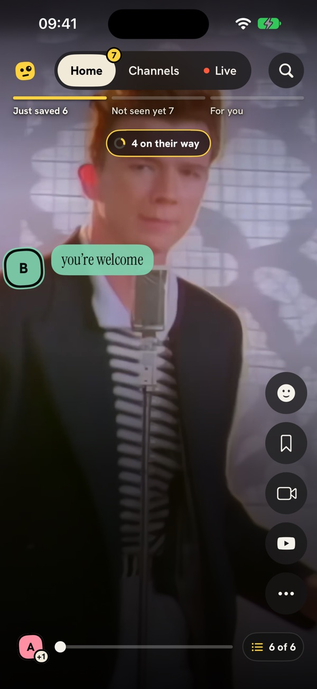
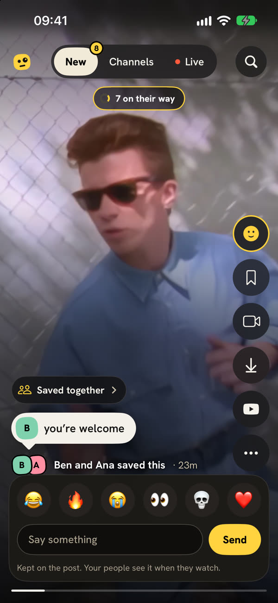
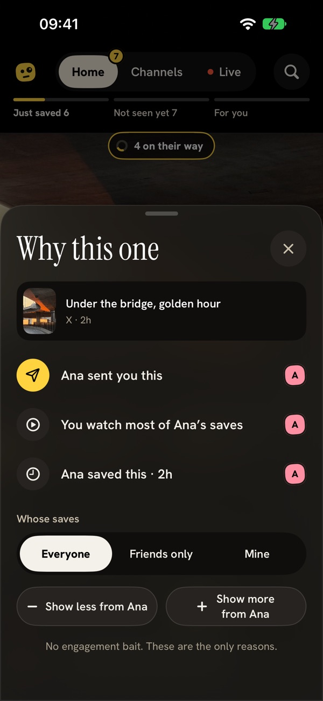
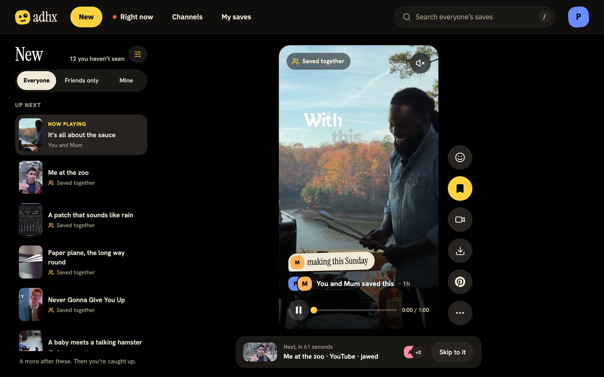
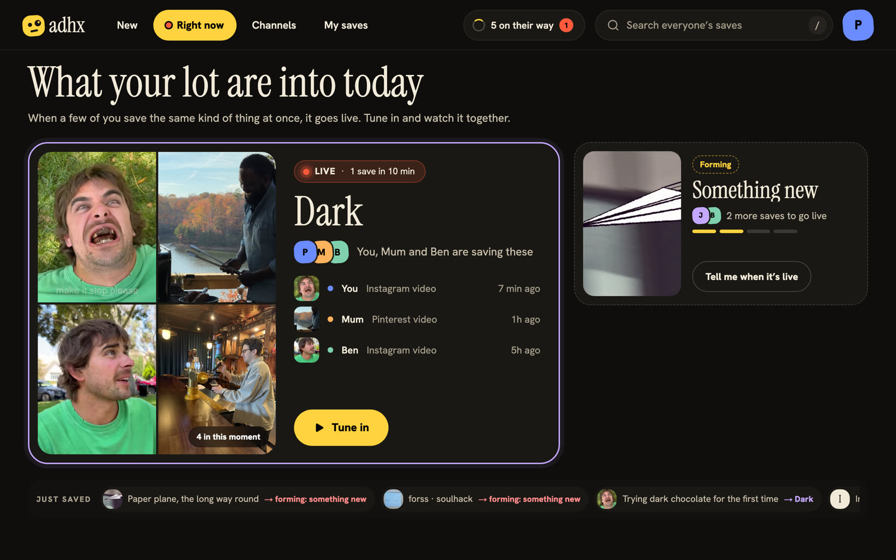
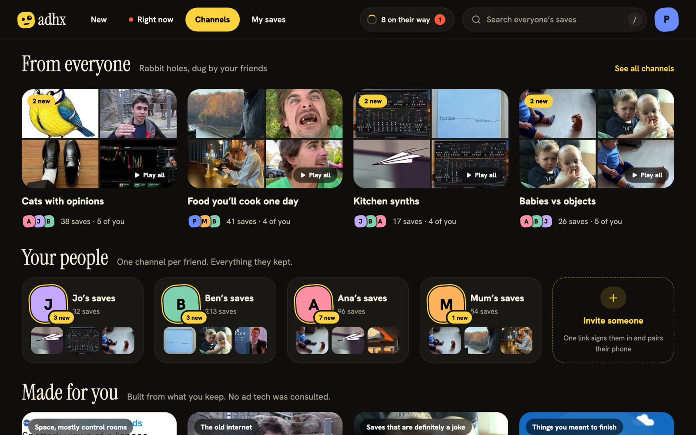
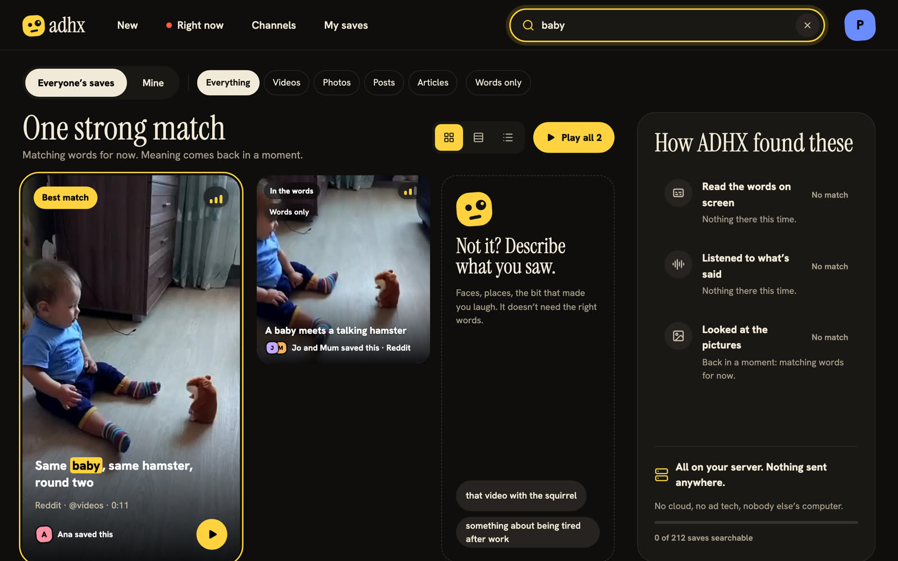
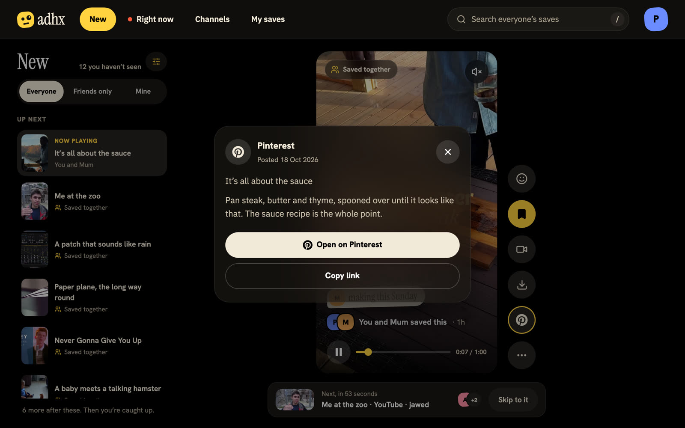
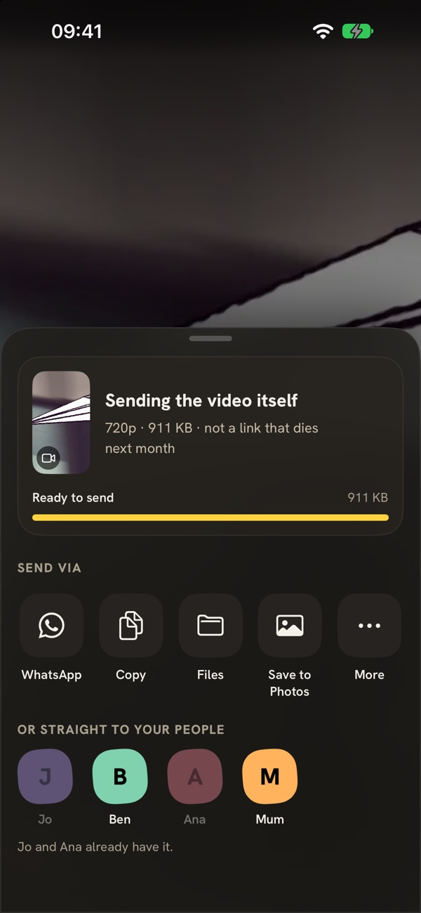
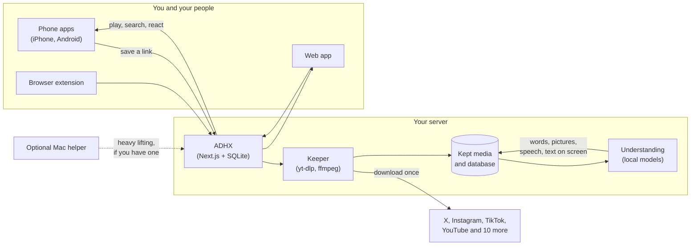

# ADHX

[](https://github.com/itsmemeworks/adhx/actions/workflows/ci.yml)
[](https://github.com/itsmemeworks/adhx/actions/workflows/release-please.yml)
[](https://opensource.org/licenses/MIT)

> **Your friends have better taste than the algorithm.**

ADHX is a private feed of the best posts from X, Instagram, TikTok, YouTube, Reddit and nine more networks, picked by your closest friends and family instead of a recommendation engine with quarterly targets.

Each of you saves the good stuff from whatever app you're in. ADHX downloads a real copy of every post, in the best quality the network offers, onto a server you run, and plays it from there. Deleted on X? Still here. Can't remember the caption? Describe it ("the baby arguing with a hamster") and ADHX finds it. Then send the actual video to the group chat, not a link that dies next month.

No ads. No strangers. No engagement metrics. Nobody in a growth meeting deciding what you see. One Docker container, one folder of data, and an invite list for the people you'd actually let in your house.

https://github.com/user-attachments/assets/56130b2a-1e79-4d70-85e9-177de0efdb91

**Look around first:** [demo.adhx.com](https://demo.adhx.com) is a live ADHX where you're Sam and your friends have been busy. Nothing to install, nothing saved.

## Contents

- [What it does](#what-it-does)
- [Supported networks](#supported-networks)
- [How it works](#how-it-works)
- [Run your own](#run-your-own)
- [The admin area](#the-admin-area)
- [Saving posts](#saving-posts)
- [Phone apps](#phone-apps)
- [Search from Claude and other agents](#search-from-claude-and-other-agents)
- [Develop locally](#develop-locally)
- [Documentation map](#documentation-map)
- [Contributing](#contributing)

## What it does

<table>
  <tr>
    <td width="33%"></td>
    <td width="33%"></td>
    <td width="33%"></td>
  </tr>
  <tr>
    <td>A friend's note floats up as it plays.</td>
    <td>React to any post. Everyone who watches it later sees it float up.</td>
    <td>Every post says why it's in your feed, and you can turn friends up or down.</td>
  </tr>
</table>

- **Home.** What your people saved that you haven't seen yet, full screen, one after another. Every post says why it's there (saved together, sent to you, a friend you watch a lot). Then it stops: "You're all caught up. Go touch grass."
- **A real copy of everything.** Every save is downloaded once, at the best quality available (up to 4K), and served by your ADHX. Nothing streams from the networks at watch time, and nothing vanishes when they delete it.
- **Search by what you remember.** Words, what's in the picture, sampled video frames, what's said in a video, and text on screen (that meme's caption, burned-in subtitles). It runs on your own server.
- **Faces and notes.** See which of your people saved what: their notes float up as the post plays, and a tap on the face shows everyone who saved it, reacted or watched. Saves are shared with your people by default; **Just for me** keeps one to yourself.
- **Reactions everywhere.** 😂 or "who sent this 💀" on any post. Reactions stay on the post, and **Channels → Reactions** plays everything your people reacted to.
- **Send the file, not the link.** Straight to a friend's Home with a note, or out to WhatsApp, Messages or anywhere else as the actual video.
- **Channels.** ADHX groups everyone's saves into rabbit holes and names them, and gives every friend a channel of everything they kept.
- **Right now.** When a few of you save the same kind of thing at once, it goes live. **Tune in** to watch together and see who's watching with you.
- **The original, when you want it.** The network's logo on every post opens who posted it, when, and everything they wrote, with a link back.
- **Invites with an optional bouncer.** Make a link, send it, they pick a name, done. Or approve each person yourself.
- **Phone apps** for iPhone and Android that do all of this, plus share-menu saving from any app.

<details>
<summary>More screenshots</summary>

<p align="center">
  
</p>

| Right now                                                                                                                                                                                  | Channels                                                                                                                                                    | Search                                                                                                                                                 |
| ------------------------------------------------------------------------------------------------------------------------------------------------------------------------------------------ | ----------------------------------------------------------------------------------------------------------------------------------------------------------- | ------------------------------------------------------------------------------------------------------------------------------------------------------ |
|  |  |  |

| The original post                                                                                                                                             | Send the real file                                                                                                                                                                                                     | Landscape                                                                                                 |
| ------------------------------------------------------------------------------------------------------------------------------------------------------------- | ---------------------------------------------------------------------------------------------------------------------------------------------------------------------------------------------------------------------- | --------------------------------------------------------------------------------------------------------- |
|  |  |  |

</details>

Screenshots use the sample friends from the [design parity harness](e2e/parity/README.md) (Pete, Ana, Ben, Mum and Jo), not anyone's real saves.

## Supported networks

| Network    | What ADHX keeps                          | Good to know                                                                    |
| ---------- | ---------------------------------------- | ------------------------------------------------------------------------------- |
| X          | Video (up to 4K), photos, text, Articles | Bookmarks can sync automatically                                                |
| Instagram  | Reels, photos and carousels              | Instagram sometimes asks servers to log in; ADHX falls back to public mirrors   |
| TikTok     | Video                                    | Photo posts keep their cover picture                                            |
| YouTube    | Video, Shorts                            | 4K is kept when the upload has it                                               |
| Facebook   | Videos and Reels                         |                                                                                 |
| Reddit     | Video with sound, pictures, text         | Reddit blocks servers from its own pages; ADHX finds the video through vxreddit |
| LinkedIn   | Video and pictures from public posts     |                                                                                 |
| Vimeo      | Video                                    | Videos protected with DRM can't be kept; ADHX keeps their picture and link      |
| SoundCloud | The track and its artwork                | Plays in the same player, artwork on screen                                     |
| Pinterest  | Video Pins and picture Pins              |                                                                                 |
| Twitch     | Clips                                    |                                                                                 |
| Threads    | Text and the post's picture              | Threads only shares a preview-sized picture without logging in                  |
| Imgur      | Images and albums                        | Imgur blocks the UK; a server there can't keep Imgur posts                      |
| Bluesky    | Video and pictures                       |                                                                                 |

Downloads run through [yt-dlp](https://github.com/yt-dlp/yt-dlp), plus each network's public link-preview data for picture posts. ADHX never asks for your passwords on any of these networks. Posts that are private, blocked or protected by DRM may not download.

## How it works



In words: you save a link from your phone, the web or the extension. Your server downloads the post once, keeps the file, and works out what's in it (words, pictures, speech, text on screen) so search can find it later. Everything you watch is played from your server. A spare Apple Silicon Mac can take the processing off a small NAS. [ARCHITECTURE.md](ARCHITECTURE.md) has the full picture.

## Run your own

ADHX isn't a hosted service: you run it. Any machine with Docker will do, with about 2 GB of memory to spare and some disk (1,000 mixed saves come to roughly 10–30 GB).

### Try it in a minute

```bash
docker run -d --name adhx -p 3000:3000 -v adhx:/data ghcr.io/itsmemeworks/adhx
docker logs adhx | grep setup
```

Open the link it prints, add your email and pick your name: you're the owner. Then invite your people from **Settings → Your people → Make a link**. There's nothing to configure: ADHX makes its own secret and works out its own address. The first start also downloads the search models (about 800 MB) in the background.

**Rather have an AI do it?** Every guide here is written by hand, but you don't have to read them. Point your favourite coding agent (Claude Code, Codex, Cursor, Gemini CLI …) at this repository and ask it to set ADHX up on your server. [`AGENTS.md`](AGENTS.md), [`CLAUDE.md`](CLAUDE.md) and the deploy recipes tell it everything it needs, from the installer to the Mac helper.

### One click, wherever you host

| Where                                                   | How                                                                                                                                                                      |
| ------------------------------------------------------- | ------------------------------------------------------------------------------------------------------------------------------------------------------------------------ |
| Any Linux server                                        | `curl -fsSL https://raw.githubusercontent.com/itsmemeworks/adhx/main/deploy/install.sh \| sudo sh` ([what it does](deploy/install.sh))                                   |
| Any Linux server with a domain, HTTPS included          | `curl -fsSL https://raw.githubusercontent.com/itsmemeworks/adhx/main/deploy/install.sh \| sudo ADHX_DOMAIN=adhx.example.com sh`                                          |
| A new server at Hetzner, DigitalOcean, Vultr, Linode, … | Paste [`deploy/cloud-init.yaml`](deploy/cloud-init.yaml) into **User data** when you create it                                                                           |
| Render                                                  | [](https://render.com/deploy?repo=https://github.com/itsmemeworks/adhx) (Standard plan + disk) |
| Railway                                                 | [Two-minute recipe](deploy/railway/README.md)                                                                                                                            |
| Fly.io                                                  | [`deploy/fly`](deploy/fly/fly.toml): four commands                                                                                                                       |
| Portainer                                               | **Settings → App Templates**, URL `https://raw.githubusercontent.com/itsmemeworks/adhx/main/deploy/portainer/templates.json`; then **App Templates → ADHX**              |
| CapRover                                                | **One-Click Apps → >> TEMPLATE <<**, paste [`deploy/caprover/adhx.yml`](deploy/caprover/adhx.yml)                                                                        |
| Zeabur                                                  | [Template](deploy/zeabur/template.yaml) (button once it's published)                                                                                                     |
| Dokploy, Coolify, CasaOS, Synology, TrueNAS             | Paste [`deploy/one-click/docker-compose.yml`](deploy/one-click/docker-compose.yml)                                                                                       |
| Your own Compose, with Caddy for HTTPS                  | [`deploy/vps`](deploy/vps/docker-compose.yml): `ADHX_DOMAIN=adhx.example.com docker compose up -d`                                                                       |
| Unraid                                                  | [Container template](deploy/unraid/adhx.xml)                                                                                                                             |
| Umbrel                                                  | [App folder](deploy/umbrel/adhx) (not in the Umbrel store yet)                                                                                                           |
| UGREEN NAS                                              | [UGOS Pro walkthrough](deploy/nas/ugreen.md)                                                                                                                             |

The installer sets up Docker if it's missing, keeps ADHX in `/opt/adhx` and prints the link that makes you the owner. Run it again to update; add `ADHX_DOMAIN` later and it moves to HTTPS with everything kept.

Wherever it runs, the first screen asks for a setup code. It's in the server log, or in the host's dashboard when the template made one (`SETUP_CODE`). That way, reaching a fresh server first isn't enough to take it over.

Sign-in has no passwords. Until you set up [email](docs/self-hosting.md#sign-in-links), sign-in links wait on the admin page for you to pass on; invite links need no email at all.

### From source

```bash
git clone https://github.com/itsmemeworks/adhx && cd adhx
cp .env.example .env
docker build -t adhx:local .
echo "ADHX_IMAGE=adhx:local" >> .env
docker compose up -d
docker compose logs adhx | grep setup
```

This [`docker-compose.yml`](docker-compose.yml) listens on `127.0.0.1:3000` (`ADHX_PORT` changes it), for your usual reverse proxy to put HTTPS in front. Everything lives in one volume at `/data`: the database, the search models, every kept file and the secret ADHX made for itself. Migrations run on start. To run a published image instead, pin `ADHX_IMAGE=ghcr.io/itsmemeworks/adhx@sha256:<digest>` from a [release](https://github.com/itsmemeworks/adhx/releases).

Where next:

| If you want to…                                                                                                | Read                                                                             |
| -------------------------------------------------------------------------------------------------------------- | -------------------------------------------------------------------------------- |
| Set up sign-in emails, decide who can join, see every setting, size your disk, or understand the search models | [Running your own ADHX](docs/self-hosting.md)                                    |
| Run it on a NAS or Docker host: storage, permissions, resource limits, HTTPS, backups                          | [Docker host and NAS guide](deploy/nas/README.md)                                |
| Use UGREEN's Docker interface                                                                                  | [UGOS Pro walkthrough](deploy/nas/ugreen.md)                                     |
| Move video understanding and conversion to an Apple Silicon Mac                                                | [Mac helper](deploy/mac/README.md) and [how it works](docs/remote-processing.md) |
| Know what's in a release and how images, the Android APK and TestFlight builds are made                        | [Build and release flow](docs/releasing.md)                                      |
| Understand database indexes, query performance and growth limits                                               | [Database performance](docs/database-performance.md)                             |
| Know exactly what your server stores and who can see it                                                        | [Privacy](PRIVACY.md)                                                            |

Kept media and shared post previews can be opened by anyone who can reach your server and knows the address. Invites and the email allowlist protect accounts, not playback, so put it on a private network or VPN if that's the boundary you want.

A new ADHX stays out of search engines: robots.txt turns crawlers away, the sitemap is empty and every page says `noindex`. Shared links still open, and still unfold into a card in chats. To be found, the owner turns on **Show up in search engines** in Admin → System → Settings (`PUBLIC_PAGES=on`). A server that already had a public channel before this switch existed keeps being listed after the upgrade, and shows the switch On.

## The admin area

The first person to set ADHX up is its admin, and **Admin** (in Settings, or `/admin`) is where you run the place. Admin is attached to the account, never to a username, and you can make other people admins from **People**.

| Section        | What it's for                                                                                                                  |
| -------------- | ------------------------------------------------------------------------------------------------------------------------------ |
| **Overview**   | Saves, people and disk at a glance.                                                                                            |
| **People**     | Who's here, who's waiting to join (let them in or decline), their phones, and who's an admin.                                  |
| **Posts**      | Everything kept on the server, by network and kind.                                                                            |
| **Channels**   | What your people made and watched together.                                                                                    |
| **Live**       | Moments as they form, and how many tuned in.                                                                                   |
| **Analytics**  | How ADHX gets used, as counts only: never what anyone searched or watched.                                                     |
| **Processing** | What's downloading, converting and being understood right now. Pause new work, retry what failed, or keep a post as a link.    |
| **System**     | Whether it's all working, and how it's set up. See below.                                                                      |
| **Moderation** | Hide a post from every public page, clear a note, or keep someone out. Every admin action is logged here.                      |
| **Invites**    | Make and revoke invite links, choose who may invite, and, until email is set up, pass on the sign-in links waiting for people. |

**System** answers "is it actually working?" in one place:

- **A map of your setup.** It shows this server (say, your UGREEN NAS) with the processes running on it, the optional Mac helper, and the outside services ADHX calls. Each one is lit green, amber or red.
- **Every queue** (keeping copies, converting videos, understanding posts). For each: what's waiting, working and failed, the oldest wait, a backlog line and a per-hour chart of what finished.
- **The Mac helper.** Whether it's connected, what it says it can do, and how many jobs it holds. If it's being turned away, it says why: a wrong token, a server that isn't set up for a helper, or a helper on a different version.
- **What's wrong, and the fix.** Anything that needs you sits right under the status line, in plain words.
- **Services and tools.** Jev, email, FxTwitter, X sync, yt-dlp, Sentry, FFmpeg and the disk: whether each is on, when it last answered, and what kind of failure it last had.
- **Settings you can change on the spot.** The Jev key, email (Resend or SMTP), who may sign up, the X app keys and how often X syncs, what gets kept (older saves too? how big? stop at how much free disk?), how closely videos are read, speech and text on screen, whether search engines may list your public pages, and a name for your server. No editing the server's settings, no restart. A value saved here beats the server's environment, and one tap goes back to it. Keys are stored encrypted and never shown again. **Test Jev** and **Send me a test email** check them for real.
- **The rest, read-only.** Paths, the processing mode and secrets like the session key are read when ADHX starts, so they're shown with where they come from and changed in the environment.

The page refreshes itself every 15 seconds, and the **System** menu entry shows a count when something is broken.

## Saving posts

- **Phone:** share from any app to **ADHX** with the [phone apps](#phone-apps).
- **Web:** paste a link anywhere in ADHX, or press **Paste**.
- **Desktop:** the [browser extension](extension/README.md) adds a toolbar button, a right-click item and `⌘⇧A` / `Ctrl+Shift+A`.
- **iPhone without the app:** **Settings → Add to the iOS share menu** walks you through a three-step Shortcut.
- **Anywhere:** put your address in front of a link, as in `https://adhx.example.com/https://www.youtube.com/watch?v=…`.
- **X bookmarks:** connect X once in Settings and new bookmarks arrive about every hour ([setup](docs/self-hosting.md#x-bookmark-sync-optional)).

Short share links (`pin.it`, Reddit's `/s/` links, `on.soundcloud.com`, `youtu.be`, TikTok's `vm.` links) work too.

## Phone apps

ADHX Share for iPhone and Android puts ADHX in your phone's share menu and plays Home, Channels and Live full screen. It reacts, searches, sends the real file, explains why each post is there, invites people, changes your picture (photo or selfie, cropped on the phone) and turns sideways for watching. The phone only ever talks to your own ADHX; it never opens the website.

**Connect it** in one of two ways:

- **Sign in with email:** type your ADHX's address and your email, then the 6-digit code it sends you. This needs [sign-in emails](docs/self-hosting.md#sign-in-links) to be set up.
- **Pairing code:** on your computer, open **Settings → Phone app → Show the code** and scan it, or type the address and the 8-character code. Joining from an invite link? The code is on the "You're in." screen.

**Install it.** The apps aren't in the stores, so [Install the phone apps](docs/install-phone-apps.md) walks you through it, step by step:

- **Android:** download `adhx-<version>.apk` from the [latest release](https://github.com/itsmemeworks/adhx/releases/latest), allow your browser to install it, done. [Obtainium](https://github.com/ImranR98/Obtainium) can watch for updates.
- **iPhone, anywhere:** TestFlight, once whoever runs your ADHX sets it up (Settings → Phone app shows the link).
- **iPhone in the EU:** [AltStore PAL](docs/install-phone-apps.md#iphone-in-the-eu), Apple's own install prompts, no weekly refresh. Needs a one-time listing by the owner.
- **iPhone everywhere else:** [SideStore](docs/install-phone-apps.md#iphone-everywhere-else) with your free Apple Account. It refreshes the app every week for you.

Code: [`apps/ios`](apps/ios/README.md) and [`apps/android`](apps/android/README.md). The API they use: [phone app spec](docs/specs/phone-app.md).

## Search from Claude and other agents

ADHX ships an [Agent Skill](https://agentskills.io) that searches your saves by meaning, pictures and videos included, and can read any X post as clean JSON.

1. In ADHX, open **Settings → Search from Claude** and make a key.
2. Set `ADHX_API_KEY` to it and `ADHX_URL` to your server's address where your agent runs.
3. Install the skill:

   ```bash
   # Claude Code
   /plugin marketplace add itsmemeworks/adhx
   /plugin install adhx

   # Other skills-compatible agents (Cursor, Gemini CLI, Codex, Copilot …)
   SKILLS_DIR="$HOME/.cursor/skills" # change this for your agent
   mkdir -p "$SKILLS_DIR/adhx" && curl -sL \
     https://raw.githubusercontent.com/itsmemeworks/adhx/main/skills/adhx/SKILL.md \
     -o "$SKILLS_DIR/adhx/SKILL.md"
   ```

Then ask something like "find my saved videos with a frog in them". Keys only read their owner's saves, and you can remove them at any time. Agents that read the web can also start from [`/llms.txt`](public/llms.txt).

## Develop locally

You need Node.js 26 (22.22.1 or newer works), Git 2.32 or newer, and the pnpm version pinned in `package.json`.

```bash
git clone https://github.com/itsmemeworks/adhx && cd adhx
pnpm install
cp .env.example .env        # then set SESSION_SECRET to: openssl rand -base64 32
pnpm db:migrate
pnpm dev                    # http://localhost:3001
```

With no email set up, sign-in links are printed in the terminal. To try downloads, install [yt-dlp](https://github.com/yt-dlp/yt-dlp) (`brew install yt-dlp` or `pipx install "yt-dlp[default]"`) and FFmpeg (`brew install ffmpeg` or `apt install ffmpeg`). The first run downloads the search model (about 400 MB) into `data/models/`; `SEMANTIC_SEARCH=off` skips it, and `KEEP_BACKFILL=off` stops it downloading your whole library.

Before you open a pull request:

```bash
pnpm typecheck && pnpm lint && pnpm test && pnpm format:check
```

| Command             | What it does                                                                                        |
| ------------------- | --------------------------------------------------------------------------------------------------- |
| `pnpm test`         | The unit and API test suite (Vitest, a few thousand tests, about a minute)                          |
| `pnpm test:e2e`     | Browser tests with Playwright, against their own server on port 3002 (`pnpm test:e2e:install` once) |
| `pnpm parity:serve` | A server full of sample friends and posts, for screenshots and the phone apps                       |
| `pnpm site:dev`     | The adhx.com product site, which is a separate app in [`site/`](site/)                              |
| `pnpm site:og`      | Redraw the site's share picture while `pnpm site:dev` runs                                          |
| `pnpm email:dev`    | Preview the sign-in emails                                                                          |

## Documentation map

| Doc                                                  | For                                                            |
| ---------------------------------------------------- | -------------------------------------------------------------- |
| [docs/README.md](docs/README.md)                     | Every other doc, sorted by what you're trying to do            |
| [ARCHITECTURE.md](ARCHITECTURE.md)                   | How the pieces fit together, with diagrams                     |
| [Install the phone apps](docs/install-phone-apps.md) | Android, and iPhone in and outside the EU, step by step        |
| [Live updates and presence](docs/realtime.md)        | Streaming, reconnect recovery, packages and polling boundaries |
| [CONTRIBUTING.md](CONTRIBUTING.md)                   | Setting up, testing, and getting a pull request merged         |
| [AGENTS.md](AGENTS.md) and [CLAUDE.md](CLAUDE.md)    | Coding agents: read these first                                |
| [PRIVACY.md](PRIVACY.md)                             | What your server stores and who can see it                     |
| [SECURITY.md](SECURITY.md)                           | How to report a vulnerability privately                        |

## Use it kindly

ADHX is for keeping posts for yourself and the people you share your server with. It isn't a way to republish other people's work. ADHX keeps the creator's name on every post; please keep it there. Each network has its own terms about downloading.

## Contributing

Issues and pull requests are welcome, from typo fixes to new networks. Start with [CONTRIBUTING.md](CONTRIBUTING.md), and please follow the [Code of Conduct](CODE_OF_CONDUCT.md). Found a security problem? Report it privately as [SECURITY.md](SECURITY.md) describes, not in a public issue.

The product site at [adhx.com](https://adhx.com) is built from [`site/`](site/) and published by hand; your own ADHX doesn't serve it.

## License

[MIT](LICENSE). Do good things with it.
