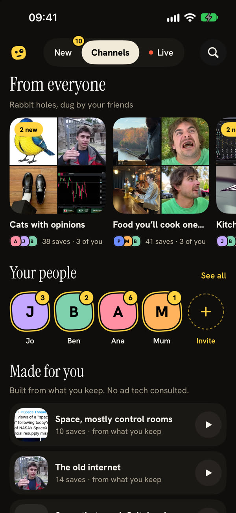
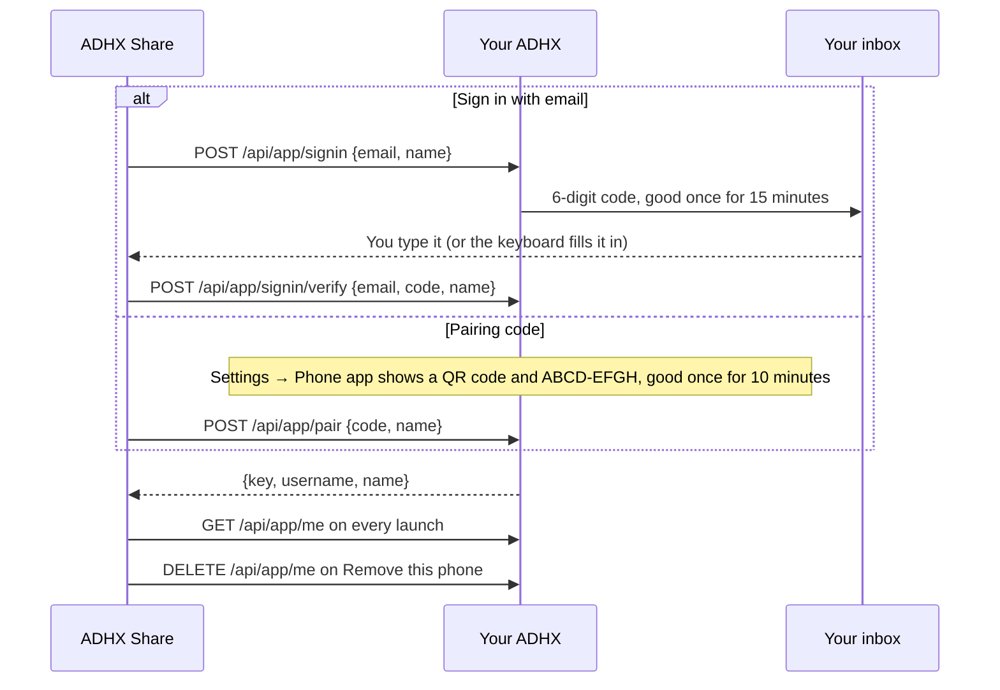

# ADHX Share for Android

ADHX Share is the Android app for your own ADHX (the server you or a friend
runs). Share a post from any app, pick **ADHX** in the share menu, and it
lands in your saves, for your people or just for you. The app plays what your
people saved full screen (swipe up for the next one), has their channels and
what's live, and searches everyone's saves by meaning.

Your ADHX does the work: it reads each post, keeps a copy of its media and
streams it back. The phone sends links and plays what comes back, and nothing
in the app opens the ADHX website.

Kotlin, Jetpack Compose and Material 3, with Media3 ExoPlayer for video and
Coil for pictures. Runs on Android 8.0 (API 26) and up, and doesn't need
Google services (the QR scanner is ZXing, not ML Kit).

<p>
  
  
</p>

> **Just want the app?** Every release has a signed `adhx-<version>.apk`
> attached. Open [the latest release](https://github.com/itsmemeworks/adhx/releases/latest)
> on your phone, tap the `.apk`, and allow installs from your browser once.
> Then sign in with your email. No Android Studio required, no store, no
> account with anyone but your friend's server.

## Quick start (building it yourself)

You need JDK 17 or newer and the Android SDK with platform 37 (SDK Manager
package `platforms;android-37.0`). Android Studio installs both.

1. Open `apps/android` in Android Studio (File → Open) and let Gradle sync.
   On the command line, tell Gradle where the SDK is with `ANDROID_HOME` or a
   `local.properties` file (see [Build it](#build-it)).
2. Plug in a phone with USB debugging on, or start an emulator.
3. Press **Run**, or `./gradlew installDebug` from `apps/android`.
4. In the app, tap **Sign in with email**, type your ADHX's address and your
   email, then the 6-digit code it sends.
5. In any app, tap Share on a post and pick **ADHX**. That's the whole trick.

## Build it

**Android Studio:** File → Open → pick `apps/android`. Let it sync, then press
Run with a phone plugged in (USB debugging on) or an emulator.

**Command line:**

```sh
cd apps/android
./gradlew assembleDebug                  # app/build/outputs/apk/debug/app-debug.apk
./gradlew assembleRelease                # app/build/outputs/apk/release/
```

The Gradle wrapper (9.8.1) is committed, so no separate Gradle install is
needed: `./gradlew` downloads it the first time. Tell Gradle where the SDK is,
either with `ANDROID_HOME` or a `local.properties` file (not committed):

```properties
sdk.dir=/Users/you/Library/Android/sdk
```

The **version** shown at the bottom of Settings (`ADHX Share 2.4.0`) comes
from `git describe` at build time (`gitBuildName()` in `app/build.gradle.kts`):
the release on its own tag, `2.4.0 +3 · abc1234` three commits after it, with
` · edited` for uncommitted changes. Release builds set it with
`ADHX_VERSION_NAME` instead.

### Connect a debug build without signing in

Debug builds can be connected to a test server directly, for example the
[design parity server](../../e2e/parity/README.md), from a script:

```sh
adb reverse tcp:3600 tcp:3600
adb shell am start -n com.adhx.share/.debug.DebugConnectActivity \
  --es server http://127.0.0.1:3600 --es key "$PHONE_KEY" [--ez welcome true]
```

`welcome` opens on the Connected screen, as after pairing. `--ez noSeen true`
marks nothing seen while that process lives, so a seeded server stays as it
was. The activity is in `src/debug`, so release builds don't have it.

## Sign a release APK

Android only installs signed APKs. The debug build is signed with a debug key
automatically; the release build is signed only when you give it a key, and
comes out as `app-release-unsigned.apk` otherwise.

Make a key once and keep it safe. Every update has to be signed with the same
key, or phones refuse to install it over the old one.

```sh
keytool -genkeypair -v -keystore adhx-release.keystore -alias adhx \
  -keyalg RSA -keysize 4096 -validity 10000
```

Then either put the details in `apps/android/keystore.properties` (ignored by git):

```properties
storeFile=adhx-release.keystore
storePassword=…
keyAlias=adhx
keyPassword=…
```

or set them in the environment (handy in CI):

```sh
export ADHX_KEYSTORE=/path/to/adhx-release.keystore
export ADHX_KEYSTORE_PASSWORD=…
export ADHX_KEY_ALIAS=adhx
export ADHX_KEY_PASSWORD=…        # optional, defaults to the store password
export ADHX_VERSION_CODE=20400    # optional, must go up with every release
export ADHX_VERSION_NAME=2.4.0    # optional; otherwise git describe
./gradlew assembleRelease
```

The signed APK is `app/build/outputs/apk/release/app-release.apk`.

## Release APKs

Every GitHub release gets a signed `adhx-<version>.apk` (and its `.sha256`)
attached by `.github/workflows/android-release.yml`, which Release Please calls
after it makes a release. The version name is the release (`2.4.0`) and the
version code comes from it (major × 10000 + minor × 100 + patch, so `20400`),
so each release installs over the last.

It needs your key as repository secrets (Settings → Secrets and variables →
Actions). Until the first three exist, the job skips with a notice and the
release still ships.

| Secret                      | Value                                                                    |
| --------------------------- | ------------------------------------------------------------------------ |
| `ANDROID_KEYSTORE_BASE64`   | The keystore, base64: `base64 -i adhx-release.keystore \| pbcopy`        |
| `ANDROID_KEYSTORE_PASSWORD` | The keystore's password                                                  |
| `ANDROID_KEY_ALIAS`         | The key's alias (`adhx` if you used the command above)                   |
| `ANDROID_KEY_PASSWORD`      | The key's password; optional when it's the same as the keystore password |

**Keep the keystore and its passwords somewhere safe and use the same key
forever.** A phone only installs an update signed with the key it already
has, so a new key means everyone uninstalls and starts again.

To attach an APK to a release that already exists (for example one made before
the secrets were added):

```sh
gh workflow run android-release.yml -f version=2.4.0
```

## Install it

- **From the release page:** open
  [the latest release](https://github.com/itsmemeworks/adhx/releases/latest)
  on the phone and tap the `.apk`. Android asks once to allow installs from
  that app (Chrome, Files…).
- **With [Obtainium](https://github.com/ImranR98/Obtainium)** (updates without
  a store): tap Add App and paste the repository's URL. Obtainium checks the
  releases page and offers each new APK as an update.
- **With adb:** `adb install -r app/build/outputs/apk/release/app-release.apk`.

To check a download, compare `sha256sum adhx-<version>.apk` with the
`.sha256` file beside it on the release.

## Connect the phone

Both ways in end with a **phone key**: a long random secret that lets this
phone act for your account, and nothing else.



In words: the phone gets a key from an emailed code or a pairing code, checks
it each launch, and cancels it when you remove the phone.

**Sign in with email** is the first way in and needs no website: type your
ADHX's address and the email you sign in with, and the app asks
`POST /api/app/signin { email, name }`. The server emails a 6-digit code. Type
it, or let the keyboard fill it in (the field is marked as a one-time code).
`POST /api/app/signin/verify { email, code, name }` answers exactly like
pairing. The app turns each error into plain words:

| Answer                | What it means                                                                      |
| --------------------- | ---------------------------------------------------------------------------------- |
| `bad_code`            | The code is wrong                                                                  |
| `expired`             | The code was used, burned (five wrong tries) or is past 15 minutes: send a new one |
| `busy`                | Too many tries: wait a little                                                      |
| `too_many`            | This account already has 10 phones                                                 |
| `too_soon`            | A code went less than a minute ago: type that one                                  |
| `no_email` (503), 404 | This ADHX can't send email (or is older): use the pairing code                     |

In development without `RESEND_API_KEY` or `SMTP_URL`, the code is in the
server log as `[sign-in-code] …`.

**With a pairing code:**

1. On a computer, open your ADHX and go to **Settings → Phone app**. It
   shows a QR code and an 8-character code (`ABCD-EFGH`) that works once, for
   10 minutes.
2. In ADHX Share, tap **Use a pairing code instead**, then point the camera
   at it. The QR code holds `adhx://pair?server=…&code=…`, so the phone's own
   camera app works too: it opens ADHX Share and connects straight away.
3. Or tap **Type the code** and type your ADHX's address and the code.

The app calls `POST /api/app/pair` with the code and the phone's model name.

### Where the key lives

The key and the address are kept in an atomic AES-256-GCM encrypted file in
the app's private `noBackupFilesDir`; the non-exportable encryption key lives
in Android Keystore. Older installs read the old EncryptedSharedPreferences
once and remove it only after the new file has been synced and decrypted
successfully. A missing key, unreadable record or full disk reports a
secure-storage error and keeps the existing files.

Pairing and disconnect only report success after their new record is durable;
a disconnect writes a tombstone so an old migration copy can't reconnect it.
A durable account-scope flag hides old history and prevents its delivery if
clearing local rows fails while switching accounts, including after a restart.
The phone's private-default preference carries the same server/account
ownership. No phone credential is included in backup or device transfer.

The key gives the app access to its account's permitted saves, friends feed,
search, live rooms and account-scoped actions. Server-side role and privacy
checks apply to each request.

Plain `http://` addresses are allowed, for an ADHX on your home network. Use
`https://` for anything on the internet.

**Remove this phone** in Settings cancels the key on your ADHX
(`DELETE /api/app/me`), then forgets the key, the list and any waiting links on
the phone. If your ADHX can't be reached it still forgets them here, and
Connect says the phone may still show in Settings → Phone app there. If you
remove it there first, the app notices next time it opens and goes back to
Connect.

## Sharing, and the offline queue

When you share to ADHX, a small frosted card slides up at the bottom of the
app you're in. On Android 12 and later the app behind is blurred; on older
phones, or with blur switched off, it's dimmed instead.

1. It finds the first `http(s)://` link in what was shared and shows the
   network's mark straight away.
2. It sends `POST /api/app/save` with `Prefer: respond-async`, so your ADHX
   answers at once and reads the post by itself (a home server can take a
   while, Instagram especially). The card then asks `GET /api/app/save?id=`
   every 1.5 s until the post is saved or turned down. Close the card early
   and your ADHX carries on; the app checks now and then so Shared lately
   catches up.
3. **Saved** shows the post and how keeping a copy is going
   (`GET /api/app/status` every 1.5 s). It closes by itself after 3 seconds
   unless you touch it. **Open in ADHX** opens the post in this app's player
   through `adhx://post?platform=…&id=…`. While its copy is still being kept,
   the player shows a shimmering card with a progress ring and plays it once
   it's ready.
4. **Already in your saves**, **That's not one post** and **Connect the app
   first** say what happened.

Every share is registered with WorkManager before it sends anything, even
when online. New saves are staged privately (`deferPublish: true`) until the
app acknowledges the latest **Just for me** choice through
`PATCH /api/app/save`. The receipt, the explicit choice (including off) and the
pending acknowledgement are stored before retrying, so closing the card or
restarting the phone can't publish a private choice or lose it. Each changed
choice increments a stored version; retries reuse it, so an already accepted
request can't undo a later privacy change on the web. The initial POST reuses
the history UUID as `requestId`, so a lost response resumes the same receipt.

If your ADHX can't be reached (no network, no answer in 15 seconds, or a
502/503/504), the card says **Saved for later** and the link goes into the
WorkManager queue. Each waiting link is one job that only runs with a network
and tries again with growing waits (30 s, 1 min, 2 min… up to 5 hours) for
about a week, across restarts. If the server turns the link down (a 4xx, like
"not a post"), the job stops and the list shows why. **Settings → Send waiting
links now** starts them all again.

**Shared lately** (in Settings) lists the last 50 completed shares plus every
unfinished delivery (kept on the phone only). Tap one to watch it in the
player; one that isn't saved (or is gone from your saves) opens the link you
shared, on its own network.

## Home: Home · Channels · Live

One light row sits on top: Gob (Settings), the tabs, and Search. The full
behaviour and endpoints are in
[the spec's friends feed section](../../docs/specs/phone-app.md#the-friends-feed-on-the-phone).

- **Home** (`GET /api/app/feed?mode=lineup`) plays the lineup (Just saved,
  Not seen yet, For you), with a count on the tab. "Ana sent you this" and
  For you's "Like … you kept" sit over the bottom row; tap one for Why this one,
  Everyone · Friends only · Mine, and **Show less from Ben** / **Show more
  from Ana** (`GET/PUT /api/app/feed/weights`). A post someone sent you leads
  with "Pete sent you this" and their face; a "Like … you kept" reason shows
  that post of yours as a small thumbnail. Tap Home again for What's in your
  feed: videos and photos by default, text posts and articles if you want
  them (`/api/app/feed/types`, also kept on the phone). Posts count as seen
  after 2 s on stage or when you swipe past (`POST /api/app/seen`, batched).
  It ends on "You're all caught up. Go touch grass."
- **Watch counts**: every player counts plays, finishes and seconds watched
  (`library/WatchTally.kt`) and sends them to `POST /api/app/watched`
  (`library/WatchCounts.kt`, kept in `adhx.watched` across restarts, cleared
  with a new connection). Nothing shows them yet.
- **Reactions** tops Channels when there are any (`GET /api/app/reacted`,
  paged): the newest posts your people reacted to, each with the last
  reaction's face and emoji (or words), "12 posts with reactions" and **Play
  all**. They play in the player, where their reactions float again.
- **Channels** (`GET /api/app/channels`): From everyone, Your people (a face
  per friend, with how many of theirs you haven't seen) and Made for you
  (My saves first), with See all and Invite. A channel opens as a grid
  (`/api/app/channels/{kind}/{slug}`) and plays from the one you tap. Posts
  you haven't saved or seen carry a yellow **New** (`isNew`), and **Play the
  4 new** plays just those. A friend's channel shows their latest note as a
  paper tile. A From everyone channel's page has **Keep this channel**
  (`POST /api/app/channels/group/{slug}/keep`), which then reads **Kept ·
  Open**; in its player the name beside Close is the keep/leave toggle
  ("+ name" keeps it, "✓ name" leaves it with `DELETE` on the same address).
- **Live** (`GET /api/app/live`): the moments your lot are saving into, with
  how busy each is ("3 saves in 10 min · Ana, Ben and Jo"). Groups still
  forming are dashed rows with a bell for **Tell me when it's live**
  (`PUT|DELETE /api/app/live/forming/{id}/alert`). The first bell asks to show
  notifications (Android 13+); after that the app checks `GET /api/app/alerts`
  every minute while open and every 15 minutes with WorkManager, on the "Live"
  notification channel. Tune in asks `/api/app/live/{slug}` every 5 s for new
  posts, who's watching and reactions (`POST /api/app/live/{slug}/react`).
- **Faces** on search tiles and in the player's who row open that friend's channel.

A server without the feed (404) keeps the old home: My saves. A feed with
nothing saved yet (`nothingYet`) says "Nothing new yet. Save something for
your people to find." instead of the caught-up page.

## The player

Every list plays in the same full-screen player: swipe up for the next post
and down for the one before; pages of 20 load as you near the end. One Media3
ExoPlayer plays whichever post is on screen and is let go when the app goes to
the background. Photo albums swipe sideways and each photo shows for 10
seconds; text posts and articles fill the page in a large serif (long ones
fade out with **Read all**, which opens a scrolling reader); SoundCloud plays
its sound over the artwork.

Down the right, top to bottom:

| Button                 | What it does                                                                                                                                                                                                                                                                                                                                       |
| ---------------------- | -------------------------------------------------------------------------------------------------------------------------------------------------------------------------------------------------------------------------------------------------------------------------------------------------------------------------------------------------- |
| **React**              | Six emoji or a few words, on every post. Yours floats up at once with your face and is kept with `POST /api/app/reactions`; if it doesn't go, it's taken back with "Couldn't send that. Try again."                                                                                                                                                |
| **Save**               | Yellow when the post is in your saves; on a friend's post it saves it to yours too.                                                                                                                                                                                                                                                                |
| **Share**              | Sends what your ADHX kept, not a link: the send sheet fetches the file and hands it to WhatsApp, Copy, Files, Save to phone or More, or sends the post straight to one of your people.                                                                                                                                                             |
| **The network's mark** | Opens the original-post sheet: who posted it, their words in full (or a kept X article), **Open on {network}** and **Copy link**.                                                                                                                                                                                                                  |
| **More**               | Save to your phone (the video, sound or every photo of an album in the gallery under ADHX, Android 10 and up), Just for me (on your own saves), Sound, Fit video, Repeat, Dock (picture in picture), Hide controls, Open on {network}, Share the video, Copy link, Copy the words and **Share an ADHX link** (only opens for people on your ADHX). |

When you land on a post, the reactions people already left float up with
their faces (the newest 12, oldest first), once per post per run. Live keeps
its own room and doesn't replay.

- **Hold** the stage to hide everything but a thin progress line; a tap brings
  it back, the next tap pauses or plays.
- **Landscape is for watching.** The app is upright everywhere except while
  media plays full screen; a sheet, the React picker or the reader over it
  keeps it upright (`ui/Orientation.kt`).
- **Sound** and **Fit video** are remembered across launches. Videos fill the
  screen by default; Fit shows them whole. **Repeat** off moves to the next
  save when a video ends; on, it loops.
- **Dock** keeps a video playing in a small window with previous and next
  buttons; it also goes there by itself when you leave the app mid-video.
- Along the bottom (layout C, boards 15.7–15.10), one row clear of the
  gesture bar: the first saver's face ("+2" when others saved it too), the
  line you drag to seek (a photo's time on a photo) and where you are ("5 of
  51", which opens Up next). Tap the face and the row shows everyone on the
  post (`GET /api/app/who`) with a sticker each in a fixed corner: saved,
  their reaction, watched; ✕ or the next post brings the line back. Friends'
  notes float up first, like reactions, in the serif. Above the row: "Pete
  replied · 2m", and the reasons faces can't say ("Ana sent you this" with
  Reply, "Like … you kept"), or a lock on your Just for me saves. A video
  that can't play says why, in the server's words.

Share downloads use separate private cache batches, so starting another share
keeps earlier recipients' files usable. Failed batches are removed at once;
batches older than 24 hours go on later exports, except downloads still
active. Share downloads check for a 64 MiB free-space reserve before starting
and while streaming.

**My saves** (`GET /api/app/saves`, under Channels → Made for you) is your own
saves, newest first. A save joins it once your ADHX has kept its copy. Until
then the server counts it in `preparing`: a pill says "2 on their way", and
with nothing else saved yet the page shows a shimmering "Getting it ready…"
card. The app looks again every 15 s.

**Search** (`GET /api/app/search`) finds everyone's saves (or, with Mine,
yours) by what you describe, not only by exact words. A two-column grid of
posters shows how close each one is; tap one to play the results from there.

## Settings, approvals and "On their way"

Gob opens **Settings**: your face (in Gob's shape) and name, then Your people,
Invite someone, What's in your feed, Just for me by default, Sound on by
default, What your ADHX is doing (with its count), "Connected to Ana's ADHX"
with **Remove this phone**, Shared lately, and the build's version at the
bottom.

- **Your people** (`GET /api/app/people`): everyone let in, with faces, save
  counts and when they last saved; a row opens their saves. Admins also see
  **Waiting for you**: Let in, Not now, and Decline
  (`POST /api/app/people/requests/{id} { decision }`).
- **Change picture**: **Choose a photo** (the system Photo Picker) or **Take a
  selfie** (the camera app, front camera when it listens; asks for the camera
  the first time), then a square crop (drag, pinch 1–4×, a round preview,
  Use / Cancel). The cropped square goes as a JPEG (at most 1024 px) to
  `POST /api/app/me/avatar`. **Use a Gob face** (blue, teal, coral, lime),
  **Use my X photo** and **Remove picture** are there too. Every "you" face
  changes at once.
- **Invite someone**: "Anyone with this link can ask to join. Nobody gets in
  until you say yes." **Make a link and share it** (`POST /api/app/invites`)
  hands the link to the system share sheet; your working links are listed
  with when they run out. The server keeps only a link's hash, so **Share
  again** makes a fresh link (`POST /api/app/invites/{id}/link`) and
  **Revoke** is `DELETE /api/app/invites/{id}`. Without `canInvite` the sheet
  says only the admin can make invites.
- **Just for me by default** and **Sound on by default** are kept on the
  phone. Until the first is touched here, saves leave `private` out and the
  account's own default on the server applies. On sends `private: true`; off
  applies only to a new save when acknowledging publication. An untouched off
  default never makes an existing private repeat shared.
- **On their way**: a pill over the Home player ("3 on their way") while posts
  are processing, asking `GET /api/app/doing` every 5 s while it's on screen
  (15 s while nothing is). Tap it for each post's picture, step and progress;
  ones that need you show why and **Retry** (`POST /api/app/doing/retry`).
  **See everything your ADHX is doing** opens the full list.

**Your face, everywhere.** Anywhere the app draws you, it uses your own
picture from `/api/app/me` (`LocalMe`, refreshed on resume and after a
change). A letter only shows when you really have no picture.

Members' pictures (`/api/files/avatar/…`) are for members only, so Coil's
OkHttp client adds the phone key to requests for the connected ADHX (same
scheme, host and port) and to nothing else.

## Dependency and storage checks

Android uses Coil 3 with its explicit OkHttp network component and
cache-control strategy. The phone key goes only to the paired scheme, host and
port; redirects to another origin lose it. Both image caches have a
credential-derived namespace (a digest, never the key itself), so pairing to
another account can't reuse the previous account's pictures. The deprecated
AndroidX `security-crypto` package remains only for one-time reads of old
pairings; new credentials use Android Keystore directly.

Build, test and write the resolved runtime Maven graph, as CI does:

```sh
cd apps/android
./gradlew --no-daemon --max-workers=2 assembleDebug testDebugUnitTest exportRuntimeDependencies
node ../../scripts/security/check-android.mjs app/build/reports/runtime-dependencies.json
```

JVM tests (`app/src/test/`) cover credential migration, failed writes and
readback, missing or wrong keys, tampering, disconnect tombstones,
origin-restricted authentication, cross-origin redirects and cache separation,
plus the feed, reactions, the original-post sheet, landscape and articles, the
share cache, and the without-the-web models (picture, invites, sign-in). They
exercise the production logic with an in-memory file and a JVM AES
implementation. Android Keystore and AtomicFile behaviour still needs the
physical-device checks below.

## Before distributing a phone build

A debug build or emulator run doesn't establish signed physical-device
behaviour. Work through the [phone acceptance checks](../../docs/rollout/phone-device-acceptance.md)
on a real phone at the final HTTPS origin: email sign-in and pairing, Remove
this phone, sharing from another app, offline queuing and retries, seek,
landscape, picture in picture, saving to the gallery and search pagination.
For the credential migration specifically:

- Use a disposable test account and the same signing key to install the
  previous paired app, then update in place. The same account works without
  pairing again, and the old encrypted preferences disappear only after the
  new record works.
- Force-stop and restart after pairing, migration and disconnect.
  Disconnected phones must stay disconnected; a failed write must never claim
  success.
- On an emulator or disposable test install only, fill its private storage,
  interrupt a write and remove its test Keystore key. The app shows an error,
  keeps its stored files and queued shares, and never sends with a guessed
  key. Recover with free space or a fresh pairing.
- Pair to another test account on the same origin. Previous private pictures
  and history are absent, images load with the new key, and no credential goes
  to an external image origin.
- Backup/restore and device transfer require fresh pairing; don't copy
  Keystore-bound credential files between devices.

## Troubleshooting

| Symptom                                            | Likely cause and fix                                                                                                                      |
| -------------------------------------------------- | ----------------------------------------------------------------------------------------------------------------------------------------- |
| `SDK location not found`                           | Set `ANDROID_HOME` or add `sdk.dir` to `apps/android/local.properties`.                                                                   |
| `Failed to find target ... android-37`             | Install `platforms;android-37.0` in the SDK Manager.                                                                                      |
| Release build comes out `app-release-unsigned.apk` | No signing values were found. Fill `keystore.properties` or the `ADHX_*` variables.                                                       |
| "App not installed" when updating                  | The new APK was signed with a different key, or has a lower version code. Use the same key and raise `ADHX_VERSION_CODE`.                 |
| The release has no APK                             | The signing secrets aren't set (the job left a notice). Add them, then `gh workflow run android-release.yml -f version=X.Y.Z`.            |
| "This ADHX can't send email" on Sign in with email | The server has no `RESEND_API_KEY` or `SMTP_URL`, or hands links to the admin. Use the pairing code from Settings → Phone app on the web. |
| An emulator can't reach a server on your computer  | Use `http://10.0.2.2:<port>`, or `adb reverse tcp:<port> tcp:<port>` and `http://127.0.0.1:<port>`.                                       |
| Channels and Live say the server needs an update   | Your ADHX is older than the app. Update it to a matching release.                                                                         |
| The app won't turn sideways                        | Only full-screen media turns. Close any sheet, the React picker or the reader first.                                                      |

## Layout

```
app/src/main/java/com/adhx/share/
  share/   ShareActivity (share target), the card, its view model
  main/    MainActivity (screens and back), Connect, email sign-in, Settings,
           Shared lately, Your people and join approvals, change picture, invites
  doing/   On their way: the pill, its sheet and the full list
  feed/    Home (Home · Channels · Live), the caught-up page, Why this one,
           channels, Live and Tuned in, the reactions row, seen batching
  library/ The player, the original-post sheet, reactions on posts, the send
           sheet, the reader, picture in picture, My saves, search, More
  alerts/  "Tell me when it's live" notifications
  work/    SaveWorker and SaveQueue (the offline queue)
  net/     AdhxApi (OkHttp + kotlinx.serialization), the JSON shapes, image auth
  data/    ConnectionStore and ConnectionVault (server + key), HistoryStore,
           SettingsPrefs and PrivateDefault
  links/   finding links, guessing the network, network names and marks
  ui/      colours, buttons, copy, faces, orientation, motion
app/src/main/res/drawable/
  ic_gob.xml          Gob, the ADHX mark
  ic_net_*.xml        network marks from simple-icons (LinkedIn is drawn by hand,
                      as Simple Icons doesn't carry it)
app/src/debug/        DebugConnectActivity (debug builds only)
app/src/test/         JVM unit tests
```
