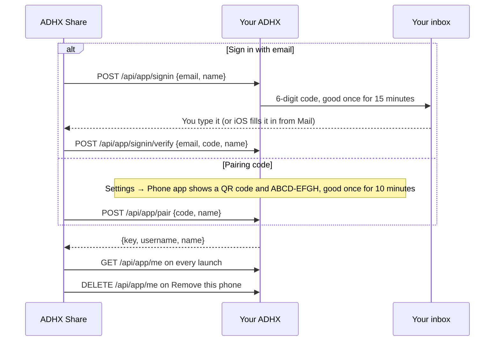

# ADHX Share for iPhone

ADHX Share is the iPhone app for your own ADHX (the server you or a friend
runs). It puts **ADHX** in the share menu of every app, so a post from
TikTok, Instagram, YouTube, X or anywhere else lands in your saves with two
taps. It also plays what your people saved, full screen, until you're all
caught up and can go touch grass.

Your ADHX does the heavy lifting: it reads each post, keeps a copy of the
media and streams it back. The phone sends links and plays what comes back.
It only ever talks to your own ADHX, and it never opens the ADHX website.

<p>
  
  
  
</p>

> **Just want the app?** If someone sent you here from their ADHX's Settings,
> ask them for a TestFlight invite: each release uploads itself to TestFlight
> once the server owner has set it up ([how](../../docs/releasing.md#iphone-app-on-testflight)).
> Otherwise you can build it yourself with the quick start below.

## Quick start

You need a Mac with Xcode 16 or newer (it's built and checked with Xcode 27)
and a phone on iOS 17 or newer. No packages, CocoaPods or other tools.

1. Open `apps/ios/Config/Base.xcconfig` and set `ADHX_BUNDLE_PREFIX` (your own
   reverse-domain id, like `com.yourname.adhxshare`) and `DEVELOPMENT_TEAM`
   (your Team ID). Details in [Set it up for yourself](#set-it-up-for-yourself).
2. Open `apps/ios/ADHXShare.xcodeproj` in Xcode.
3. Pick the **ADHX Share** scheme and your phone, then press **Run**.
4. In the app, tap **Sign in with email**, type your ADHX's address and your
   email, then the 6-digit code it sends you.
5. Open any app, tap Share on a post, pick **ADHX**. Done. That's the whole trick.

## What's in it

The app has two parts that work as one.

- **The app** (`App/`) opens on **New**: what your people saved that you
  haven't seen, full screen, swipe up for the next. Beside it sit
  **Channels** (rabbit holes from everyone, one per friend, ones made from
  what you keep, and **Reactions**, every post your people reacted to) and
  **Live** (what a few of you are saving right now, to tune in to together).
  It searches everyone's saves or just yours by meaning, and Settings has
  you, your people, invites, defaults and this phone.
- **The Share Extension** (`ShareExtension/`) is the card you see after
  picking ADHX in the share menu: Saving, Saved, Already in your saves,
  That's not one post, Saved for later, and Connect the app first. It says
  who will see the save and has a **Just for me** switch.

Code both parts use lives in `Shared/`: talking to your ADHX (`API.swift`,
`FriendsAPI.swift`, `AccountAPI.swift`), faces and names (`People.swift`),
members' pictures loaded with the phone key (`AuthImage.swift`), storage, the
list of waiting links, network marks, colours and the share card itself. The
API and every screen's copy are specified in
[the phone app spec](../../docs/specs/phone-app.md).

### The player

Every list (New, a channel, Reactions, Live, My saves, search results) plays
in the same full-screen player.

- **Down the right**: React, Save, Share, Save to Photos, the post's network
  mark and More. Live adds its own React for the room.
- **React** works on every post, not only in Live: six emoji or a few words.
  Yours floats up at once with your face. When you land on a post, the
  reactions people already left float up again (the newest 12).
- **The network mark** opens the original-post sheet: who posted it, their
  words in full, **Open on {network}** and **Copy link**.
- **Share** sends the kept file itself (Send via WhatsApp, Copy, Files, Save
  to Photos or More for the system share sheet), or the post straight to one
  of your people.
- **More** has Why this one, Just for me and your note, Sound, Fit video,
  Repeat, Dock (picture in picture) and Hide.
- **Hold** the stage to hide the buttons; tap to bring them back, tap again to
  pause or play. Photos show for 10 seconds each, then the next photo or save.
- **Landscape is for watching.** The app turns sideways only while the player
  is the top screen; anything over it (a sheet, the React picker) keeps it
  upright (`App/Orientation.swift`).
- Sheets over the player are frosted, and short messages appear in the top
  pill's place for a few seconds instead of stacking up.

### Settings

Gob (top left) opens Settings: your face and name, **Change picture**,
**Your people**, **Invite someone**, What's in your feed, Just for me by
default, Sound on by default, what your ADHX is doing, Shared lately, and
**Remove this phone**. The bottom line says which build you're running, for
example `ADHX Share 2.4.0` on a release, or `2.4.0 +3 · abc1234` three
commits after it (written by `Config/stamp-version.sh` at build time).

<p>
  
  
</p>

- **Change picture**: choose a photo or take a selfie, crop it square with pan
  and pinch under a round preview, or pick a Gob face, your X photo or none
  (`POST`/`DELETE /api/app/me/avatar`). Your face changes everywhere at once.
- **Invite someone**: make a link and send it with the share sheet; list and
  revoke your links (`/api/app/invites`). Only the link's hash is kept, so
  **Share again** makes a fresh link.

## Set it up for yourself

Open `Config/Base.xcconfig` and change two lines:

```
ADHX_BUNDLE_PREFIX = com.yourname.adhxshare
DEVELOPMENT_TEAM = ABCDE12345
```

- `ADHX_BUNDLE_PREFIX` is your own reverse-domain name. The app's id becomes
  `com.yourname.adhxshare`, the extension's
  `com.yourname.adhxshare.ShareExtension`, and the App Group
  `group.com.yourname.adhxshare`.
- `DEVELOPMENT_TEAM` is your Team ID, from developer.apple.com → Account →
  Membership.

If you'd rather not change a tracked file, put the same two lines in
`Config/Local.xcconfig` (git ignores it; `Base.xcconfig` reads it last).

To put it on your own phone you need an Apple Developer account. A free
account can install to your own phone, but App Groups (which let the Share
Extension see the connection) need a paid one. See
[App Group and Keychain](#app-group-and-keychain).

## Build

**In Xcode:** open `apps/ios/ADHXShare.xcodeproj`, pick the **ADHX Share**
scheme and a phone or simulator, press Run. With your team set, Xcode makes the
app ids and the App Group for you (Signing & Capabilities).

**From the command line** (from the repo root), a simulator build with no
signing, the same one CI runs:

```sh
xcodebuild -project apps/ios/ADHXShare.xcodeproj -scheme "ADHX Share" \
  -sdk iphonesimulator -destination 'generic/platform=iOS Simulator' \
  -derivedDataPath apps/ios/build CODE_SIGNING_ALLOWED=NO build
```

Then install and open it on a running simulator:

```sh
xcrun simctl install booted "apps/ios/build/Build/Products/Debug-iphonesimulator/ADHX Share.app"
xcrun simctl launch booted "$(grep '^ADHX_BUNDLE_PREFIX' apps/ios/Config/Base.xcconfig | cut -d= -f2 | tr -d ' ')"
```

An unsigned build has no App Group and no Keychain, so the app and the Share
Extension can't share the connection: the card will say "Connect the app
first". To try the whole flow on a simulator, sign it locally instead (no
account needed), which keeps the entitlements:

```sh
xcodebuild ... CODE_SIGN_IDENTITY=- CODE_SIGN_STYLE=Manual build
```

**Tests** that need no simulator are plain `swiftc` programs. The commands are
in [`Tests/README.md`](Tests/README.md).

## How connecting works

There are two ways in. Both end with the same thing: a **phone key**, a
long random secret that lets this phone act for your account and nothing else.



In words: the phone gets a key either from an emailed code or from a pairing
code shown on the web, checks it on each launch, and cancels it when removed.

**Sign in with email** (the usual way, no website needed): on Connect, type
your ADHX's address and the email you sign in with. Your ADHX emails a 6-digit
code (existing accounts only). Type it, or let iOS fill it in from Mail. An
ADHX that can't send email answers `no_email`, and the app points you to the
pairing code instead. In development without email, the code is in the server
log as `[sign-in-code] …`.

**With a pairing code** (for servers that don't send email):

1. On a computer, open your ADHX → Settings → Phone app. It shows a QR code
   and an 8-character code (like `ABCD-EFGH`) that works once, for 10 minutes.
2. The QR code holds `adhx://pair?server=<your ADHX address>&code=<code>`.
   Scan it with the app's camera, or with the phone's own Camera app (the
   `adhx://` link opens ADHX Share and connects straight away). Or tap "Type
   the code instead" and type both.
3. The app sends the code to `POST /api/app/pair` with the phone's model
   name.

The key can save links, read their status, read and search saves, play the
friends feed, react, send, and change your own picture and invites, as a
signed-in member could; nothing else. The app checks it with `GET /api/app/me`
when it opens. If you removed the phone on your ADHX, the app forgets the key
and goes back to Connect.

**Remove this phone** in Settings cancels the key on your ADHX
(`DELETE /api/app/me`), then forgets the key, the Shared lately list and any
waiting links on the phone. Your saves stay on your ADHX. If your ADHX can't
be reached it still forgets them here, and Connect says the phone may still
show in Settings → Phone app there.

Addresses without `http://` or `https://` get `https://`, except local ones
(`localhost`, `*.local`, IP addresses), which get `http://`. Plain `http://`
only works on your local network (`NSAllowsLocalNetworking`). If your ADHX is
on plain `http://` on the internet, put it behind https, or add your own App
Transport Security exception in `Config/*-Info.plist`.

## App Group and Keychain

The app and the extension are separate programs, so they share through an App
Group, `group.<your prefix>`:

- The server address, the Shared lately list and the waiting links live in the
  App Group's shared settings.
- The phone key lives in the Keychain, in the App Group's access group, so
  both can read it. It's readable after the phone's first unlock so waiting
  links can go in the background.

The group id comes from the `ADHXAppGroup` key in each Info.plist, so it
always follows `ADHX_BUNDLE_PREFIX`. Both targets list the group in their
entitlements (`Config/*.entitlements`).

When they aren't available (unsigned simulator builds), the app falls back to
its own settings and, on the simulator only, keeps the key in those settings.
A phone build never keeps the key outside the Keychain.

With a free developer account, remove the App Groups capability from both
targets. The app still connects, but the Share Extension can't see the
connection.

## When your ADHX can't be reached

If sending a link gets no answer, times out (15 seconds), or gets a 502, 503
or 504, the link waits on the phone ("Saved for later"). Waiting links go
when the app opens or comes back to the front, from Settings → "Send waiting
links now", and in the background through a background refresh task
(`<prefix>.flush`). iOS decides when that runs, so patience is a virtue here.

## The friends feed

Your people see what you save, named, unless you switch **Just for me** (on
the share card, or in the player's More). The app only shows names the
server sends it, which it does for members only.

- **New** plays videos and photos unless you switch on text posts or
  articles (tap New again). The choice is saved on your ADHX
  (`/api/app/feed/types`) and on the phone, for servers that don't keep it.
- **New** marks a post seen after 2 seconds on screen, or as soon as you swipe
  past it, and sends them to `/api/app/seen` in batches.
- The share card names your people from the last Channels or feed the app
  loaded (kept on the phone in the App Group, cleared on Remove this phone),
  or says "Your people will see it".
- **Reactions** on a post are kept (`/api/app/reactions`); the Reactions row
  in Channels plays every post with reactions (`/api/app/reacted`), replaying
  each one's reactions.
- **Live** refreshes every 5 seconds while you're tuned in and in the
  foreground. A screen-specific presence lease expires after 15 seconds if the
  phone disconnects; leaving or backgrounding sends an explicit leave. Existing
  saver metadata refreshes without jumping playback, and explicit removals are
  distinguished from posts falling outside the latest page.
- **Live reactions** (an emoji, or up to 40 Unicode code points) go to
  `/api/app/live/{slug}/react` and float up after acknowledgement. Failed words
  stay available for Retry against the original post. They're room chatter,
  not stored messages.
- **Why this one** has Show less / Show more from a friend
  (`/api/app/feed/weights`); a friend's channel marks what you haven't seen
  (`isNew`), plays just those, and shows their latest note; Live says how
  busy a moment is (`recentSaves` in `windowMinutes`) and lists groups still
  forming. Details in [the spec's iPhone notes](../../docs/specs/phone-app.md#iphone-notes).
- The why, filter and On their way sheets are the boards' own bottom sheets
  (`App/BoardSheet.swift`); Share opens the send sheet
  (`App/Library/SendSheet.swift`), which downloads the kept file and hands it
  on, or sends the post straight to one of your people (it shows in their New
  as "Pete sent you this").
- Forming groups on Live have a bell, "Tell me when it's live". When one goes
  live you get a local notification (`App/Feed/LiveAlerts.swift`), from a
  poll while the app is open and a background refresh task
  (`<prefix>.alerts`, beside `<prefix>.flush` in `Config/App-Info.plist`);
  tapping it tunes in. The app asks to show notifications on the first bell.
- A From everyone channel can be kept as one of yours (Keep this channel,
  then Kept · Open).
- On an ADHX without these endpoints yet (404), New plays your saves as
  before, and Channels and Live say the server needs an update.

Search follows the server's `nextOffset` as you reach the end of the result
grid or its player. Further-page failures keep the results already loaded and
offer a retry. Changing the query cancels the older page request.

### Privacy choices and the share history

The share card confirms its privacy choice against the server queue before
finishing the extension. New saves stay private until that confirmation, even
if metadata finishes first. An interrupted confirmation is kept in Shared
lately and retried on the next refresh. Each changed choice gets a persisted
monotonic version; retries reuse it so an already accepted request can't undo
a later privacy edit on the web. A genuinely new explicit choice is a new
mutation. This uses `deferPublish` and `PATCH /api/app/save`, so update the
server before testing a newly built app against it.

History lives in an atomic JSON file in the private app-group container
(moved automatically from the old app-group preference). A file lock protects
each read/change/write across the app and extension, and unfinished receipts
and acknowledgements are kept beyond the recent-history limit. The queue
records an accepted receipt before removing its offline entry. Each initial
save reuses its stored history UUID as `requestId`, so a lost initial response
returns the same receipt after a restart. Unfinished offline entries can be
rebuilt from history if interrupted.

For regression commands and the cross-device recovery matrix, see
[Friends-feed reliability checks](../../docs/rollout/friends-feed-verification.md).

## Network marks and fonts

The marks come from [Simple Icons](https://simpleicons.org) (CC0), copied into
`Shared/NetworkPaths.swift` and drawn by a small SVG path reader
(`Shared/SVGPath.swift`). LinkedIn asked Simple Icons not to carry its logo,
so LinkedIn gets a plain "in" tile, as on the website. To update them after
bumping `simple-icons`, copy each icon's `d` attribute from
`node_modules/simple-icons/icons/<name>.svg` into `NetworkPaths.swift`.

Headings use Instrument Serif and everything else Hanken Grotesk. Both are
bundled in `Shared/Fonts/` (SIL Open Font License, licences beside them) and
registered for the app and the Share Extension on first use (`BundledFonts` in
`Shared/Theme.swift`). Hanken Grotesk is one variable `.woff2`; each weight is
picked on its `wght` axis. Without them the app falls back to the system serif
and sans.

## Debug launch arguments

Debug builds read a few launch arguments, for the simulator and design checks
(`xcrun simctl launch <device> <bundle id> …`):

| Argument                                                 | What it does                                                           |
| -------------------------------------------------------- | ---------------------------------------------------------------------- |
| `-adhxServer <url> -adhxKey <phone key> [-adhxUser <n>]` | Connects without signing in or pairing                                 |
| `-adhxDryRun YES`                                        | Never tells the server what you've watched, so a test server stays put |
| `-adhxWelcome YES`                                       | Shows the "Connected to …" screen that follows pairing                 |
| `-adhxSharePreview saved\|private`                       | Shows the share card's Saved state over a post, without sharing        |
| `-adhxTuneIn <slug>`                                     | Does what tapping a "… is live" notification does                      |

The [design parity server](../../e2e/parity/README.md) writes phone keys you
can pass to `-adhxKey`.

## Before testing on a physical phone

A simulator build doesn't establish device signing, App Group/Keychain sharing,
background execution or picture in picture. Before handing a build to anyone,
work through the [phone acceptance checks](../../docs/rollout/phone-device-acceptance.md),
at least:

- Sign in by email and by pairing code at the final HTTPS origin, then Remove
  this phone and confirm the key stops working on the server.
- Share a real supported post from another app, then repeat offline and retry.
- Confirm the main app and Share Extension use the same connection.
- Play and seek a kept video, turn the phone sideways, try picture in picture
  and save to Photos.
- Search beyond the first results page, change queries during loading and
  retry a failed page.

An unsigned simulator build is not evidence that these passed.

## TestFlight

Releases upload themselves: `.github/workflows/ios-testflight.yml` archives the
release tag and sends it to TestFlight once the repository has the App Store
Connect key and signing secrets. It skips with a notice until then. Setup,
secrets and the one-time App Store Connect steps are in
[iPhone app on TestFlight](../../docs/releasing.md#iphone-app-on-testflight).

By hand, from Xcode:

1. Set `ADHX_BUNDLE_PREFIX` and `DEVELOPMENT_TEAM` as above.
2. On developer.apple.com, make sure the two ids (`<prefix>`,
   `<prefix>.ShareExtension`) and the App Group (`group.<prefix>`) exist,
   with the App Group turned on for both ids. Xcode's automatic signing
   usually does this for you.
3. In App Store Connect, create an app with the id `<prefix>`.
4. In Xcode: pick "Any iOS Device", then Product → Archive, then Distribute
   App → App Store Connect → Upload.
5. In App Store Connect → TestFlight, add yourself and your friends as
   testers. Each new upload needs a higher build number
   (`CURRENT_PROJECT_VERSION`).

The app says it uses no non-exempt encryption (it only uses https), so
TestFlight won't ask about export rules.

## Troubleshooting

| Symptom                                                      | Likely cause and fix                                                                                                                              |
| ------------------------------------------------------------ | ------------------------------------------------------------------------------------------------------------------------------------------------- |
| The share card says "Connect the app first" after signing in | The app and extension can't share the connection: an unsigned build, or no App Group. Sign the build (see [Build](#build)) or use a paid account. |
| "This ADHX doesn't send email" on Sign in with email         | The server has no `RESEND_API_KEY` or `SMTP_URL`, or hands links to the admin. Use the pairing code from Settings → Phone app on the web.         |
| The code never arrives in development                        | Without email it's printed in the server log as `[sign-in-code] …`.                                                                               |
| Can't connect to an `http://` address                        | Plain `http://` only works on your local network. Put your ADHX behind https.                                                                     |
| Channels and Live say the server needs an update             | Your ADHX is older than the app. Update the server to a matching release.                                                                         |
| Faces show as letters                                        | Pictures are members only and load with the phone key; check the phone is still connected (Settings), or the person chose the letter.             |
| Waiting links don't go in the background                     | iOS decides when background refresh runs. Open the app, or use Settings → Send waiting links now.                                                 |
| The app won't turn sideways                                  | Only the player turns. Close any sheet or the React picker first.                                                                                 |
| TestFlight job says the secrets aren't set                   | Add all seven secrets listed in [docs/releasing.md](../../docs/releasing.md#secrets).                                                             |

## Files

```
apps/ios/
  ADHXShare.xcodeproj    the project (folders are synced; new files join automatically)
  Config/                Base.xcconfig, Info.plists, entitlements, stamp-version.sh
  App/                   the app: Connect, email sign-in, the camera, orientation, Shared lately
    Feed/                New, Channels, Live, the Reactions feed, live alerts, Why this one
    Library/             the player, reactions, the send sheet, search, My saves
    Settings/            Settings, your people, change picture and its crop, invites
    Doing/               On their way
  ShareExtension/        the extension's entry point and how it reads the shared link
  Shared/                used by both: API, storage, queue, marks, theme, the share card
  Tests/                 swiftc regression suites (see Tests/README.md)
```
