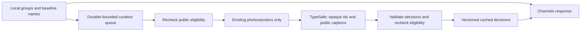

# Optional image-aware channel curation

ADHX can use TypeSafe's experimental image API to refine **Made for you** and
**From everyone** channels. Local embeddings still form the groups. The optional
pass can choose a better display name from the existing name list, leave a
clearly off-topic borderline post out of a generated channel, space apparent
reposts apart during playback, and choose more representative channel covers.

It never deletes a save, changes an original file, merges posts, renames a
manually kept/tagged channel, or changes a channel's slug. This first version
selects channel cover **posts**, using already retained posters/photos; it does
not extract or replace a video's poster. Friend channels and manually made
channels keep their existing behaviour.

## Enable deliberately

The [TypeSafe image API](https://docs.typesafe.ai/images) is experimental.
An existing Jev key alone **does not** enable image uploads. On the ADHX server:

```dotenv
TYPESAFE_API_KEY=YOUR_DEDICATED_PRIVATE_KEY
TYPESAFE_CHANNEL_IMAGES=on
```

Both Compose examples pass these through. Keep the secret in the instance's
private environment, recreate only ADHX through the normal release update
procedure, and open Channels to enqueue eligible generated channels. No extra
Mac setting, new model, GPU service or database mount is needed. It uses the
pinned `jev-1.14.0` model and the required experimental-image header.

Admins can use **Pause new work** to stop new image-curation claims alongside
downloads and understanding. In-flight work finishes; queued work resumes when
unpaused. Clearing an account’s data also removes its private image-curation jobs.

Set `TYPESAFE_CHANNEL_IMAGES=off` and recreate ADHX to stop uploads and return to
the baseline channels. No library reset or re-index is required. Only small
derived jobs/decisions are cached; disabling does not erase the bounded cache
immediately. Account deletion cascades that account's cache entries.

## What leaves the server

Only a small selection of existing retained still images and the posts' own
public-source captions are uploaded. Source eligibility is rechecked before
upload and again before accepting an answer: a post must have a non-private,
non-quoted save from a non-banned account and must not be moderated hidden.
Private-only posts are never uploaded. Publicly saved copies of the same source
post remain eligible. A private item can stay in its owner's local channel
without being submitted for curation.

Requests use opaque ids such as `p0`, not post keys or account ids. They do not
include saver names, friend relationships, private tags, save notes, search
history, locally extracted transcripts/OCR, sign-in tokens or worker credentials.
No private uploads are supported by this feature. Original images remain on the
server. The provider receives resized image copies, so its processing and data
policies apply; this is a separate choice from local understanding.

## Background flow and limits



This image pass adds only local metadata reads and enqueueing to page requests;
it does not await image preparation or TypeSafe. Existing grouping/text naming
can still run when constructing a baseline. Later reads pick up image decisions.
Web and native phone clients consume the same server channel/cover responses;
existing shares keep their slug. Display-name collisions retain baseline names.

- One job runs at a time; the worker checks every ten seconds. Jobs survive
  restarts and abandoned claims recover after one minute.
- At most one job starts per minute, with a persisted cap of **48 attempts per
  UTC day** across the instance, including failures. Further work waits.
- At most eight samples per channel: up to five central posts and three
  borderline members. Repetition comparisons cover neighbouring samples,
  not every pair in the library. This is bounded curation, not exhaustive
  duplicate detection.
- Local image preparation is sequential. Input is limited to 8 MiB/16 million
  pixels; each prepared JPEG is upright, stripped of metadata, padded to
  448×448 and capped at 96 KiB. There is no thumbnail download or FFmpeg/model
  invocation on the server for this pass. Only raster image signatures are
  accepted; SVG/PDF and their resource references are never rendered.
- The API request has a 15-second deadline; response bodies cap at 64 KiB.
  The client makes no immediate retries. Jobs retry after five then thirty
  minutes, with at most three attempts before keeping the baseline.
- The cache/queue holds at most 256 channel entries with a seven-day lifetime.
  Keys include the scope, post order, public eligibility, retained-file
  version, captions, name list, model and policy version. Stale in-flight
  answers cannot overwrite a replacement job. No image bytes or raw provider
  replies are stored in the database.

Names require confidence ≥0.8; exclusion and repeat judgments require ≥0.95.
Only sampled borderline members can be excluded, with at least two central
samples as evidence, and never if fewer than four posts would remain. Poster-only
video/audio samples cannot cause a membership exclusion, regardless of provider
confidence: one still cannot establish the contents of the whole clip. Repeated
posts are spread out when alternatives exist and still play eventually. Covers
prefer a mean quality score ≥2.5/4 with confidence ≥0.35, allowing uncertainty
between adjacent good/excellent levels. These are conservative starting rules,
not calibrated accuracy guarantees. Low-confidence or malformed answers,
missing images, timeouts and rate limits keep the established behaviour.

## Verification and quality evaluation

Regression tests cover explicit opt-in, bounded transport, account isolation,
privacy changes before upload/during a request, original-file preservation,
unsafe local paths, uncertain decisions, non-destructive repeat spacing,
transitive cover diversity, restart recovery, stale results and retry budgets.

`scripts/smoke-channel-images.ts` generates eight illustrations in memory and
performs one real request. It accepts no library path or URL. Set the two env
values privately, then run `pnpm exec tsx scripts/smoke-channel-images.ts`.
It writes a private report in the OS temporary directory (override
`ADHX_CHANNEL_SMOKE_REPORT`). A development canary took about 0.5 seconds and
correctly named cats, found repeated illustrations and rejected the pasta
outlier. This proves plumbing on synthetic content, not real-library quality.

Before enabling broadly, compare the baseline and refined channels on an
operator-approved set of public-source posts. Check topic/name fit, useful posts
wrongly excluded, repetition, cover relevance and response time on web and phone.
Include silent videos, memes with tiny text, misleading posters and similar
subjects with different purposes. Never upload a private library merely to test
this feature. A sampled poster cannot prove the contents of an entire video.
