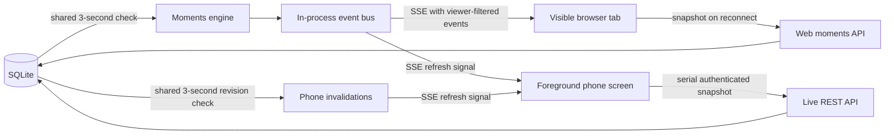

# Live updates and presence

Live uses Server-Sent Events (SSE) on the web, iPhone and Android. An open
HTTP response delivers server changes as they happen. Sending a reaction or
saving a post remains an ordinary authenticated request. SSE fits this
one-way update traffic without a separate socket server.

## Transports and packages

| Part           | Implementation                                            | Reason                                                                                                                 |
| -------------- | --------------------------------------------------------- | ---------------------------------------------------------------------------------------------------------------------- |
| Web            | Browser `EventSource`, Web `ReadableStream` on the server | Built-in SSE framing, reconnect and HTTP streaming                                                                     |
| Server fan-out | Node `EventEmitter`                                       | One app process owns the moments engine and presence                                                                   |
| iPhone         | Foundation `URLSession.AsyncBytes`                        | Native streaming and cancellation, no extra dependency; a bounded SSE parser accepts invalidations                     |
| Android        | Official `com.squareup.okhttp3:okhttp-sse:5.5.0`          | Matches the existing OkHttp core version and owns SSE framing and cancellation; coroutine flows conflate invalidations |

The event bus is transient, not a durable message queue. Saves and post
reactions are stored in SQLite; reconnecting clients fetch current state.
There are no replay IDs or exactly-once delivery guarantees. The existing
deployment contract is one app process and one SQLite volume. Multiple app
replicas would need shared presence, shared pubsub and a different database
deployment design; adding Redis alone would not provide that contract.

## What streams, and what still polls

| Consumer                                                                                          | Healthy operation                                                          | Recovery                                                                                                                                                        |
| ------------------------------------------------------------------------------------------------- | -------------------------------------------------------------------------- | --------------------------------------------------------------------------------------------------------------------------------------------------------------- |
| Web Live list, moment detail and tuned-in theater                                                 | `/api/moments/stream`; viewer-filtered saves, groups, counts and reactions | Snapshot on every open/reconnect; bounded startup-event replay; list snapshot failures back off                                                                 |
| Phone Live list                                                                                   | `/api/app/live/stream`; payload-free `refresh` signals                     | Snapshot on open/reconnect and after changes; 30-second reconciliation; 20-second REST fallback if streaming is unavailable                                     |
| Phone tuned-in room                                                                               | `/api/app/live/{slug}/stream?notify=1`; payload-free `refresh` signals     | Authoritative detail POST including known posts, removals and saver updates; 20-second room heartbeat refresh; 30-second reconciliation; 5-second REST fallback |
| Processing progress, pending share receipts, device pairing, bell notifications and worker claims | Existing bounded request polling                                           | These have separate lifecycles and are not converted by the Live transport                                                                                      |

The phone's one-second local timer checks whether reconciliation or fallback
is due; it does not make a network request every second. Refreshes are serial,
with one pending signal and at least a one-second gap between requests, so a
burst cannot create a growing request queue. Older servers still work through
REST fallback. The per-room stream's original full-event protocol is retained
when `notify=1` is absent.

The server moments engine checks for new saves every three seconds while
active and regroups every five minutes. A separate cheap durable save-revision
check runs every three seconds **once for all connected notification streams**,
including changes made by another process. It stops with the last subscriber.
Revision values, post identifiers and saved content are never included in the
notification signal; the subsequent API request applies the viewer's normal
access rules. Events can therefore arrive after the next engine/revision tick,
rather than immediately at the original database commit.

## Presence and connection lifetime

Presence counts accounts once across tabs and phones. Names are resolved only
for members; anonymous visitors receive counts. Each event and 20-second
heartbeat rechecks approval, bans and the phone's exact key. Authorization or
visibility failures close the stream instead of releasing unfiltered data.
Bearer keys stay in headers, and native stream clients reject redirects.

Streams close when a screen backgrounds, a tab hides, a screen leaves or its
account changes. Polling fallback renews a credential- and screen-scoped
15-second lease; leaving sends an explicit leave. Cancellation releases stream
listeners and presence. Silent network loss is bounded by a randomized
45–60-second server stream lifetime. Planned rotation gets a short reconnect
bridge (three seconds for a phone key, five for a named browser member), so a
normal reconnect does not repeatedly blink a member out of the room. Presence
is approximate during outages, not an instantaneous offline detector.

A slow reader can queue at most 1 MiB of output before its server subscription
closes. Browser snapshot recovery buffers at most 256 pending events and
requests a fresh snapshot on overflow. Native clients buffer one invalidation,
not a history of payloads. Web reconnect recovery adds missed posts without
remounting the video currently playing.

## Verification

Automated regressions exercise SSE framing, bearer headers and redirect refusal,
reconnect resync, burst coalescing, serial snapshots, fallback, cancellation,
visibility failures, revocation, reconnect grace, bounded buffers and cleanup.
A synthetic 100-subscriber test asserts that one revision tick performs one
shared revision read, not 100 reads. This is a query-count assertion, not a
production throughput benchmark.

Native builds and logical lifecycle tests do not prove background behavior on
real phones. Before release, use the [phone acceptance checklist](rollout/phone-device-acceptance.md):
two accounts watching one room, a reaction and a new save, Wi-Fi/cellular
handoff, background/foreground, airplane mode, key revocation and account
switching. Check that playback stays put, names recover, no signed-out data
survives a switch, and requests stop when the screen leaves.
