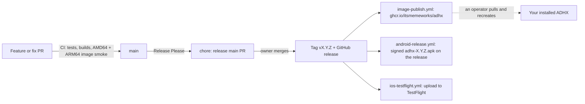

# Builds, images and releases

Container images are published only for tagged releases. Merge application PRs
into `main`, then merge the Release Please PR when ready to ship the accumulated
changes. Ordinary main pushes do not publish images. Documentation-only commits
do not initiate a release. Publishing an image does not update an installed
service or publish the website.



In words: merged PRs pile up on `main` until the owner merges the release PR;
that one merge tags the release and fans out to the container image, the
Android APK and the TestFlight upload. Nothing updates a running server by
itself.

**Handy commands** (each takes an existing release version):

```sh
gh workflow run image-publish.yml -f version=2.4.0      # republish a release's image
gh workflow run android-release.yml -f version=2.4.0    # (re)attach the signed APK
gh workflow run ios-testflight.yml -f version=2.4.0     # upload that release to TestFlight
```

| Stage               | Work                                                                                                                                                                                                                                                                                                                                                                              |
| ------------------- | --------------------------------------------------------------------------------------------------------------------------------------------------------------------------------------------------------------------------------------------------------------------------------------------------------------------------------------------------------------------------------- |
| Application PR      | Tests, lint/types/format, production audit, extension/site builds, browser tests and native AMD64/ARM64 runner-image smoke checks. The required `build` check depends on both native image builds; it does not compile the app again.                                                                                                                                             |
| Ordinary main merge | Release Please updates its pending release PR when releasable changes exist. No container publication.                                                                                                                                                                                                                                                                            |
| Release PR          | Validate bot identity, repository/branch and actual three-file diff. Only package version, matching root manifest version and changelog changes are allowed. No repeated full application CI suite.                                                                                                                                                                               |
| Release PR merge    | Release Please creates the tag and GitHub release, then explicitly calls the publisher for that version. Build AMD64/ARM64 once, publish the immutable SHA and numbered tags, and update stable aliases for the latest stable release.                                                                                                                                            |
| Android APK         | The same release run calls `android-release.yml`, which signs `adhx-<version>.apk` with the repository's signing secrets and attaches it (and its SHA-256) to the release. It skips with a notice until the secrets exist; `gh workflow run android-release.yml -f version=X.Y.Z` attaches one to an existing release.                                                            |
| iPhone TestFlight   | The same release run calls `ios-testflight.yml`, which archives the iPhone app and its Share Extension at the release tag, signs it for the App Store and uploads it to TestFlight. It skips with a notice until the secrets exist; `gh workflow run ios-testflight.yml -f version=X.Y.Z` uploads an existing release. See [iPhone app on TestFlight](#iphone-app-on-testflight). |
| Recovery            | Manually publish an existing release version. Reuse an existing SHA image when available.                                                                                                                                                                                                                                                                                         |

PR runner images remain necessary to validate both supported architectures, but
are not published to GHCR. Protected main requires build, format and test checks
with an up-to-date base. BuildKit caches are reused during release publication.
There is no automatic image build on individual feature/fix/docs PR merges.

## Why releases use an explicit publisher

Release Please uses `GITHUB_TOKEN`. GitHub suppresses most downstream workflow
events created with that token, so a release event alone is insufficient. The
release workflow calls the image workflow explicitly, only when
`release_created` is true. The image workflow has no `push` or `release` event
trigger, so publishing the GitHub release cannot start a second automatic build.
Per-commit concurrency and the immutable SHA tag also prevent rebuilds during
manual recovery. The Android APK workflow is called the same way, alongside
the image publisher, with only `contents: write` (to attach the
APK); its secrets and setup are in [`apps/android/README.md`](../apps/android/README.md#release-apks).
The iPhone TestFlight workflow is called the same way with only
`contents: read`; its setup is [below](#iphone-app-on-testflight). See [GitHub's event rules](https://docs.github.com/en/actions/how-tos/write-workflows/choose-when-workflows-run/trigger-a-workflow)
and [Release Please's documentation](https://github.com/googleapis/release-please-action#other-actions-on-release-please-prs).

The owner merges the Release Please PR. The configured `docs`, `style`, `chore`,
`refactor`, `test`, `build` and `ci` changelog sections are hidden, so commits of
those types alone do not initiate a release. Use accurate Conventional Commit
titles; `feat`, `fix`, `perf`, `security`, `revert` and breaking changes can be
release-worthy. Documentation still ships in the next release with application
changes. Release Please does not invoke the legacy Fly deployment; that workflow
and the Pages website remain explicit opt-in operations.

The trusted `workflow_run` metadata job reports the three branch-required check
names only after reading and validating the release PR's actual contents at its
immutable base/head revisions. It never checks out or executes the release PR's
code. These are metadata checks, not claims that the entire suite was rerun.
Feature PRs cannot bypass CI by choosing a release-like branch name.

## Single-package release identity

The root release configuration intentionally sets both `component` and
`package-name` to empty strings, while `include-component-in-tag` stays false.
This keeps the grouped branch `release-please--branches--main`, the title
`chore: release main`, and plain `v2.1.0`-style tags consistent.

Release Please 17.6.0 treats an empty `component` alone as a request to fall back
to the Node package name. Its grouped single-package PR has no branch/body
component, so the release parser then reports that the PR component does not
match the configured package component and produces no release. An explicit
empty `package-name` disables that fallback. It does not rename `package.json`.

The action is pinned to a commit bundling Release Please 17.6.0. The isolated
tools in `.github/release-please/` lock that same library version and exercise
its actual config loader, Node PR builder, manifest merge plugin and release
parser. They reproduce the previous failure and check feature/patch releases,
merged-commit identity, unchanged package name, component rejection and the
documentation-only policy without making GitHub writes or network calls.

```sh
pnpm --dir .github/release-please install --frozen-lockfile --ignore-scripts
pnpm --dir .github/release-please test
```

PR CI runs these compatibility tests separately from the application suite.
When updating the action, check its committed dependency lock, update the action
pin and test-library pin together, and repeat the round trip before shipping.
The test tools stay outside the application's production dependency tree.

## iPhone app on TestFlight

`.github/workflows/ios-testflight.yml` turns each release into a TestFlight
build, so friends with iPhones install ADHX Share from Apple's TestFlight app
instead of building it in Xcode. It checks out `v<version>` with its tags,
selects the newest stable Xcode on the `macos-26` runner image, archives the
**ADHX Share** scheme (app + Share Extension) for `generic/platform=iOS` and runs
`xcodebuild -exportArchive` with `method: app-store-connect` and
`destination: upload`. No fastlane, and no provisioning profiles to keep:
automatic signing with an App Store Connect API key (`-allowProvisioningUpdates`)
registers the ids and makes the profiles.

- **Version**: `CFBundleShortVersionString` is the release (`2.3.0`) in both
  targets, and Settings still shows it from `Config/stamp-version.sh`
  (`git describe` on the tag).
- **Build number**: `CFBundleVersion` is the workflow run's id
  (`github.run_id`). It increases across every run in the repository, so a
  hand-run upload of an existing release always gets a fresh, higher build; a
  called workflow's `run_number` would be Release Please's counter instead.
- **Settings stay out of git**: `ADHX_BUNDLE_PREFIX`, `DEVELOPMENT_TEAM`, the
  version and the build go on the `xcodebuild` command line; nothing tracked
  changes, so the stamp reads a clean tag.

### Secrets

Add these under Settings → Secrets and variables → Actions. Until all seven
exist the job skips with a notice and the release still ships.

| Secret                        | Value                                                                                                                                                          |
| ----------------------------- | -------------------------------------------------------------------------------------------------------------------------------------------------------------- |
| `APPSTORE_CONNECT_API_KEY_ID` | Key ID of an App Store Connect **Team** API key (App Store Connect → Users and Access → Integrations → App Store Connect API) with the **Admin** role          |
| `APPSTORE_CONNECT_ISSUER_ID`  | The Issuer ID shown above that keys list                                                                                                                       |
| `APPSTORE_CONNECT_API_KEY_P8` | The downloaded `AuthKey_<id>.p8`, base64: `base64 -i AuthKey_ABC123.p8 \| pbcopy` (pasting the file's text also works)                                         |
| `IOS_DIST_CERT_P12_BASE64`    | An **Apple Distribution** certificate with its private key, exported from Keychain Access as `.p12`, base64: `base64 -i dist.p12 \| pbcopy`                    |
| `IOS_DIST_CERT_PASSWORD`      | The password you gave that `.p12`                                                                                                                              |
| `IOS_TEAM_ID`                 | The 10-character Team ID (developer.apple.com → Account → Membership)                                                                                          |
| `IOS_BUNDLE_PREFIX`           | The app's bundle id, the same as `ADHX_BUNDLE_PREFIX` in your `Config/Local.xcconfig` (the extension is `<prefix>.ShareExtension`, the group `group.<prefix>`) |

The key needs **Admin** because automatic signing creates certificates and
profiles through it; App Manager can't. Xcode archives with a development
identity and re-signs for the App Store on export. If the `.p12` holds only the
distribution identity, Xcode makes a development certificate through the key on
each fresh runner; export your **Apple Development** identity into the same
`.p12` (select both in Keychain Access → Export Items) to reuse one instead, and
revoke stray "Created via API" development certificates if they pile up.

### Once, in Apple's portals

1. developer.apple.com → Certificates, Identifiers & Profiles → Identifiers:
   make sure the App IDs `<prefix>` and `<prefix>.ShareExtension` exist, and an
   App Group `group.<prefix>` with the App Groups capability turned on for both
   ids and assigned to that group. (Xcode's automatic signing usually does this
   the first time you run the app from Xcode with your team.)
2. App Store Connect → Apps → **+** → New App: iOS, any name, bundle id
   `<prefix>`. Only the app gets a record; the Share Extension ships inside it.
3. After the first upload has processed: TestFlight → add an internal group
   (people on your team, no review) or an external group (friends by email or a
   public link; the first build of each version goes through Beta App Review).
   The app already declares no non-exempt encryption, so builds don't stop on
   the export-compliance question.

To upload an existing release (for example one made before the secrets were
added):

```sh
gh workflow run ios-testflight.yml -f version=2.3.0
```

## Tags and safe updates

- `sha-<40-character-commit>` identifies one source revision and is reused on
  retries. The OCI index records that revision.
- The legacy `main` tag is no longer updated. Existing installations following it
  must choose a numbered release or `latest`, preferably pinning its verified digest.
- `2.1.3` identifies a numbered release and refuses replacement by a different
  digest. `2.1`, `2` and `latest` follow the latest stable GitHub release.
- Prereleases get their version tag without stable aliases.

For an installed service, verify the intended image's revision and platforms,
then pin its digest. Preserve the data mount, session secret, credentials and
canonical URL. Follow the [NAS update/backup guide](../deploy/nas/README.md#updates-backups-and-recovery).

## Recovery

Rerun a failed publishing job, or manually run **Publish container image** on
`main`. Enter `2.1.3` (or `v2.1.3`) to resolve and recover that exact existing
release tag. A version is mandatory; untagged main snapshots cannot be published. The tag must
match the package version and belong to main's history. A numbered release can
reuse an already-published SHA image; it never overwrites another release digest.
Old releases produced before SHA tags were introduced may need their original
workflow version to recover rather than replacing an existing numbered image.

If Release Please fails, fix the reported cause and rerun it. Do not fabricate a
tag from the newest manifest for an arbitrary older PR. Its normal action uses
[the manifest configuration](../release-please-config.json) and upstream default
title formatting. No PAT is required for this pipeline.

A merged version PR alone is not evidence that a GitHub release or image exists.
For a component-mismatch incident, verify the release candidate against the
merged PR's title, body version and exact merge commit before recovery; do not
edit an unrelated package identity or tag the newest `main` opportunistically.
Once an intended release exists, recover only that version through the publisher
above. Neither merging a release fix nor recovering an image updates services.
