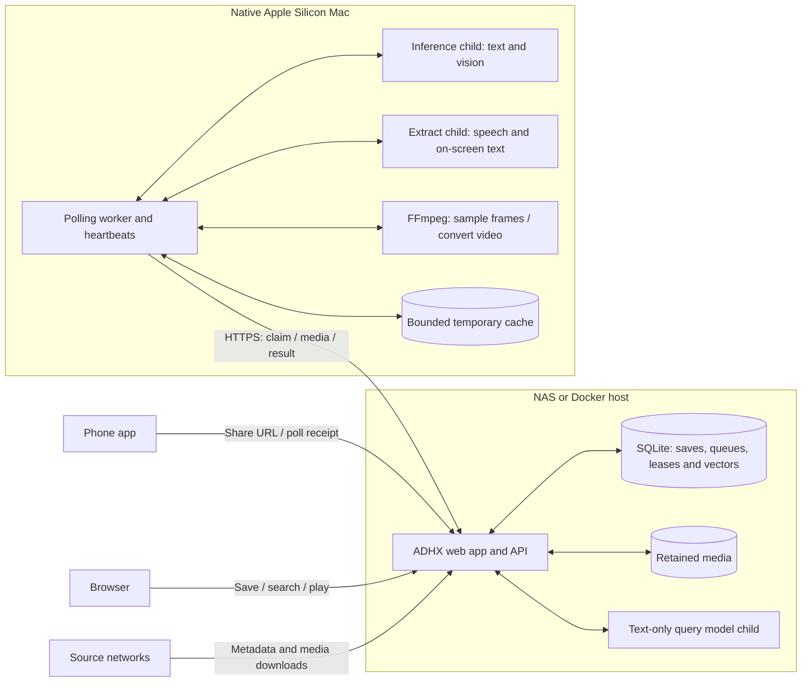
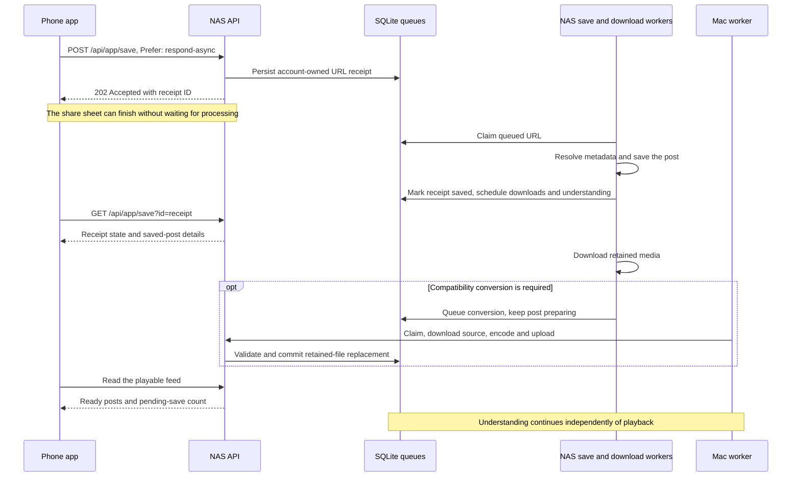
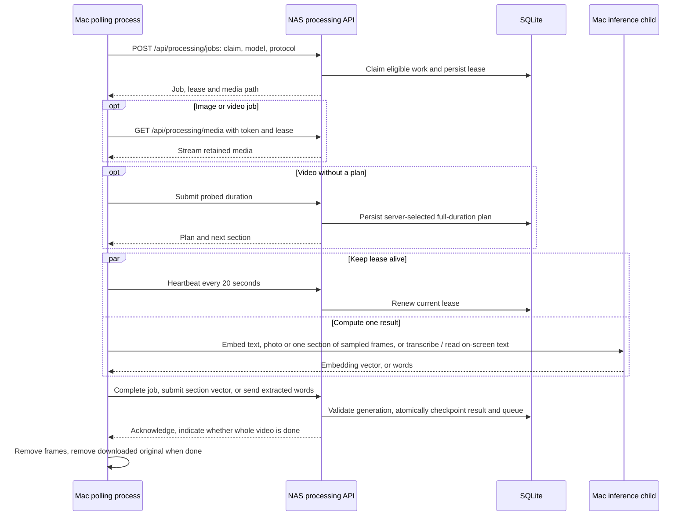
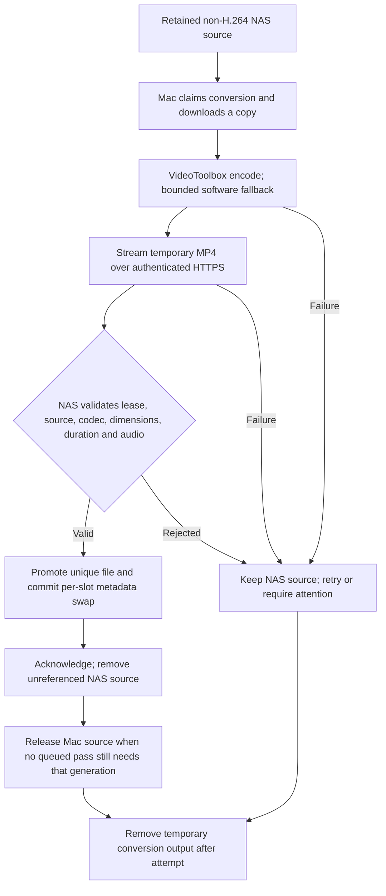

# How NAS and Mac processing work

ADHX can keep the web app, library and searches on a small Docker host while a
native Apple Silicon Mac processes the expensive background work. The NAS owns
the durable state. The Mac pulls leased jobs over HTTPS, returns results and
cleans up its temporary files.

For installation, use the [Mac setup guide](../deploy/mac/README.md) and
[verification checklist](../deploy/mac/VERIFY.md). This document describes the
current implementation. For the rest of ADHX, see
[Architecture](../ARCHITECTURE.md).

## Where each part runs

| Responsibility           | NAS / Docker host                                                 | Mac worker                                                                                |
| ------------------------ | ----------------------------------------------------------------- | ----------------------------------------------------------------------------------------- |
| Accounts and library     | Owns accounts, phone pairing, X credentials and saves             | Uses a separate machine credential                                                        |
| Source ingestion         | Resolves shared URLs, imports X and downloads originals           | Downloads only retained content granted by its job                                        |
| Playback                 | Stores and serves retained media                                  | Has temporary working copies                                                              |
| Background understanding | Owns priorities, leases, checkpoints, vectors and extracted words | Embeds text, photos and sampled video frames; transcribes speech and reads on-screen text |
| Compatibility conversion | Validates uploads and promotes the result                         | Encodes full-resolution H.264/AAC                                                         |
| Search                   | Encodes queries, combines keyword/vector scores and applies scope | Builds the background vectors                                                             |
| Persistence              | Authoritative database and media backup                           | Disposable scratch and a separate reusable model cache                                    |

`PROCESSING_MODE=remote` suppresses the NAS's heavy indexing child. The query
model, keyword index, download worker and cheap media probes stay on the NAS.
Inference runs in a separate Mac child so it cannot block the polling process's
lease heartbeats. The login service uses `Standard` scheduling and `Nice=10`;
CPU inference defaults to two threads. These are not hard RAM limits.

The runner uses native Node.js, ONNX Runtime and FFmpeg. VideoToolbox provides
hardware decoding/encoding where supported, with software fallbacks. CPU is the
inference baseline; CoreML is opt-in and needs latency and memory tests.
Docker and Apple Container are not required on the Mac.

## A shared link becomes a playable save

There are several durable stages, rather than one long phone request. A receipt
means the server accepted a URL; its media and search vectors may not be ready.

The account-owned `phone_save_queue` tracks waiting, working, saved or failed
URLs. New native shares use `deferPublish` to stage saves privately until their
chosen privacy is acknowledged by `PATCH /api/app/save`. The monotonic
`intentVersion` is persisted on the phone and server; an accepted acknowledgement
whose response was lost can be retried without undoing a later web privacy edit.
A stable per-account `requestId` also resumes the same receipt after a lost
initial POST response; reusing it with a different URL returns a conflict. The phone persists its receipt so it can follow the same request after an
interruption. Older clients without `Prefer: respond-async` use the synchronous
save path. X imports and browser saves join the downstream media/understanding
stages without using phone receipts.

The phone feed accounts for pending saves, downloads and conversions. It does
not wait for semantic understanding to finish before showing a playable save.
Word search and already-computed vectors can be useful while the rest of the
library is still being understood.

## Claim, compute, checkpoint

The machine credential authenticates requests; each claim supplies a short-lived
job lease. The shared token cannot authorize an expired or replaced job result.

Claims use two-minute leases renewed by heartbeats. Results are checked against
the current lease, pinned model, content generation and video profile. Stale
results after a source change, deletion or moderation are rejected. The pinned
EmbeddingGemma 2 model produces 768-dimensional vectors with q4 text weights and
a q8 vision encoder.

Speech and on-screen text are processed too, entirely on your own hardware: the
NAS in local mode, the Mac in remote mode. Nothing is sent to any outside
service for this. A `speech` job leases the retained video (or a sound-only
post's audio); the Mac transcribes the first ten minutes with the pinned
Whisper base model (fp32 encoder, 8-bit decoder, language detected per
30-second window) and drops silence, music and invented outro lines. A `screen`
job leases up to four retained pictures plus the video, fetched one at a time by
`slot`; the Mac reads them and four frames from the first minute with the pinned
Florence-2 base model (8-bit), dropping slivers and stray marks. The Mac sends
back only the cleaned words with `extracted`; the NAS applies the same filter
again, stores them in `post_extracted_text`, rewrites the post's keyword row and
queues its text vector again in the same transaction. Video-consuming learning
waits for all conversion slots of that post, so file replacement cannot
immediately invalidate an expensive speech or OCR pass. Both models run in a
separate extract process that holds one model at a time and exits when idle.

The protocol is versioned. Version 2 workers send `protocol: 2` and the `kinds`
they can do (`SEMANTIC_SPEECH=off` / `SEMANTIC_SCREEN_TEXT=off` on the Mac leaves
one out); the server only hands out kinds it has switched on. Optional `media.cacheKey`
identifies one retained-file generation independently of its learning kind, so
speech, text on screen and video sections can share one downloaded original.
`releaseMedia` acknowledgements and bounded claim reconciliation on subsequent polls removes copies
with no remaining consumer, including cancelled/deleted sources. Expiry and the
scratch budget bound leftovers when the server cannot be reached. Older workers
ignore these additive fields; older servers retain per-kind caching. A version 1
worker is still accepted and is only ever given text, image, video and
conversion jobs, so it never sees a kind it doesn't know. A newer kind a
version 2 worker doesn't recognise is deferred back to the queue.

Claims alternate between conversion and understanding, with the turn persisted
on the server. An empty class yields immediately; pausing indexing still allows
conversion. Conversion alternates newest-save and oldest-source ordering.
Within understanding, fresh saves and Up next start above imports and backfill,
while each minute waiting adds one effective priority point so old work cannot
be starved indefinitely. Within a priority, words come first, then pictures,
speech, on-screen text and video. Each completed video section releases its
lease and returns unfinished work to backfill priority, giving new saves another
chance to run. Failures use bounded retries with backoff and can ultimately need
operator attention.

If the Mac sleeps, logs out or loses connectivity, the NAS keeps the queue and
accepted checkpoints. Expired leases can be reclaimed. Restarting resumes from
the next accepted section; the NAS does not automatically switch to heavy local
inference. Work may be retried or recomputed; lease and generation checks protect
committed state rather than promising exactly-once execution.

## Elastic video understanding

Remote mode samples across the full duration, including the final section.
Longer videos get more sections, with bounded frames per section. The local
processing mode still uses its original first-32-seconds sampling.

| Server `INDEXING_LEVEL` | Target section length | Target frame spacing |
| ----------------------- | --------------------- | -------------------- |
| `light`                 | 120 seconds           | 12 seconds           |
| `normal`                | 60 seconds            | 4 seconds            |
| `deep`                  | 30 seconds            | 2 seconds            |

The plan divides the duration into equal sections and samples each at evenly
spaced cell midpoints. Actual spacing depends on duration: the targets are not
an exact one-frame-every-N-seconds guarantee. Each section has at most 16 frames;
each video has at most 512 sections and may be at most 24 hours long. Very long
videos use wider spacing when the section cap is reached.

For example, a ten-minute video at normal detail has ten 60-second sections,
each with 15 samples. A 126-second video has three 42-second sections, each with
11 samples. Both cover the ending. Sampling can miss brief events; speech is
transcribed by its own job (above).

`video_index_state` records the plan and next section; `video_segments` stores
acknowledged section vectors. Search can use finished sections before the whole
video completes. It takes the best section score per post, so longer videos do
not get extra votes for having more sections. A final aggregate also supports
channels and similarity. Changing detail invalidates remote video generations;
text and photo vectors remain reusable.

Search stays on the NAS: its query child embeds the query, then search combines
word matches with text, image and video scores under account and moderation
filters. Optional Jev refinement receives query and candidate public text, not
media files. It is separate from the Mac processing protocol.

## Original quality, conversion and cleanup

Inference downsizes temporary JPEG frames to 448 pixels wide. It does not
downscale or replace the retained NAS video. Compatibility conversion is separate:
H.264/yuv420p with AAC preserves full source dimensions and duration but re-encodes
the media, so it is not a byte-identical archive.

With `KEEP_H264=on`, non-H.264 slots queue for conversion before inference; all
required video slots must finish before phone-feed readiness. The NAS preserves
the source until validation and the database swap commit. Upload size, free
space, concurrency and deadline limits apply even if the proxy accepts a request.
Verify promoted-file playback too: an upload log alone is insufficient evidence.

| Mac data                                                     | Lifetime                                                                          |
| ------------------------------------------------------------ | --------------------------------------------------------------------------------- |
| Downloaded photo or completed video's working copy           | Shared across kinds; removed after final queued consumer acknowledges             |
| Unfinished video's working copy                              | Reused between sections; can expire or be evicted to meet budget                  |
| Sampled frames                                               | Removed after each section, including failures                                    |
| Speech samples and on-screen text frames                     | Removed after each job, including failures; crash leftovers swept as scratch      |
| Conversion output                                            | Removed after each upload attempt                                                 |
| Partial downloads and abandoned frame/conversion directories | Startup/periodic cleanup; one-hour expiry, earlier eviction under budget pressure |
| Orphaned originals                                           | 24-hour expiry during cleanup, earlier eviction under budget pressure             |
| Model weights                                                | Separate reusable cache, retained across jobs and updates                         |

The default worker budget is 8 GiB of scratch and 4 GiB per file, including space
reserved for active frame, OCR, audio or conversion output. Every input in the
current job is pinned during pruning; insufficient space defers the job without
deleting its active inputs. A job that cannot fit is deferred
rather than allowing unbounded growth. Use one runner per cache directory.
Cleanup runs while the worker runs; offline crash leftovers wait until startup.
Logs need a host log-rotation policy and are separate from media scratch. NAS
library files and intentional backups have their own retention policies.

## Connection and operational boundaries

The Mac initiates every network request to `ADHX_SERVER_URL`, using the same
HTTPS origin as clients. No NAS share, database mount, inbound listener or new
public port is needed. Keep the intended LAN/VPN boundary. The NAS still contacts
source networks; model weights need an initial download unless provisioned.

Server `PROCESSING_WORKER_TOKEN` must equal Mac `ADHX_WORKER_TOKEN`. It grants
instance-wide machine processing access, so a worker is a trusted host, not an
account-isolated client. Use a dedicated secret, private files and normal
certificate validation. Media transfers also require the current lease;
account cookies and phone keys do not authorize this protocol.

`SEMANTIC_SEARCH=off` pauses inference; conversion can continue.
`KEEP_MEDIA=off` separately pauses new downloads and new conversion claims.
Neither clears saved data. Remote migration preserves the library; clearing an
account is not a required setup step or a guaranteed cold-cache reset.

Use the [verification checklist](../deploy/mac/VERIFY.md) to prove completed work,
a search match near a long video's ending, conversion playback, scratch cleanup
and responsive shared services. Health, queue progress and installed process
settings establish different things; check all before a bulk import.

## Implementation map

| Area                                  | Source                                                                                                                                                                             |
| ------------------------------------- | ---------------------------------------------------------------------------------------------------------------------------------------------------------------------------------- |
| Phone receipts and metadata queue     | [`save/route.ts`](../src/app/api/app/save/route.ts), [`save-queue.ts`](../src/lib/app/save-queue.ts)                                                                               |
| Phone-feed readiness                  | [`phone-post.ts`](../src/lib/app/phone-post.ts)                                                                                                                                    |
| Authentication and protocol           | [`auth.ts`](../src/lib/processing/auth.ts), [`protocol.ts`](../src/lib/processing/protocol.ts)                                                                                     |
| Claims and atomic checkpoints         | [`jobs.ts`](../src/lib/processing/jobs.ts)                                                                                                                                         |
| Video plans and scoring               | [`profiles.ts`](../src/lib/processing/profiles.ts), [`segment-search.ts`](../src/lib/processing/segment-search.ts)                                                                 |
| Native worker, conversion and scratch | [`mac-runner.ts`](../src/lib/processing/mac-runner.ts)                                                                                                                             |
| Upload validation and promotion       | [`result/route.ts`](../src/app/api/processing/result/route.ts), [`conversion.ts`](../src/lib/processing/conversion.ts)                                                             |
| Model pin and runtime                 | [`config.ts`](../src/lib/semantic/config.ts), [`model.ts`](../src/lib/semantic/model.ts)                                                                                           |
| Speech and on-screen text             | [`extract-model.ts`](../src/lib/semantic/extract-model.ts), [`extract-media.ts`](../src/lib/semantic/extract-media.ts), [`extract-clean.ts`](../src/lib/semantic/extract-clean.ts) |
